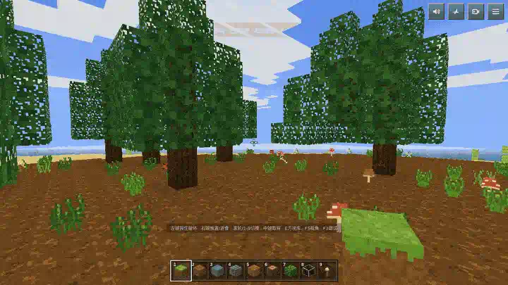

# Minecraft TS —— TypeScript 体素引擎复刻

<p align="center">
  
</p>

<p align="center">
  <b><a href="https://qwerrrtttyyy.github.io/minecraft-web-replica/">▶ 在线试玩</a></b>
  &nbsp;·&nbsp; <a href="#快速开始">本地运行</a>
  &nbsp;·&nbsp; <a href="docs/ARCHITECTURE.md">架构</a>
  &nbsp;·&nbsp; <a href="docs/TESTING.md">测试</a>
  &nbsp;·&nbsp; <a href="#english-summary">English</a>
</p>

<p align="center">
  <a href="https://github.com/qwerrrtttyyy/minecraft-web-replica/actions/workflows/verify.yml"></a>
  <a href="https://github.com/qwerrrtttyyy/minecraft-web-replica/tags"></a>
  
  
  
  <a href="LICENSE"></a>
</p>

> 🤖 **本项目完全由 AI 生成**——全部源码、测试与文档均出自 AI 编程代理，人类仅提出方向。  
> ⚠️ **警告：项目处于激进改进阶段**——迭代极快，API、存档格式与游戏行为随时可能变动，请勿用于生产环境。  
> 📖 生成方式、审核边界与质量边界见 [「关于本项目（诚实说明）」](#关于本项目诚实说明)。

**简体中文** | [English](README_EN.md)

一个架构清晰、依赖极轻的前端 Minecraft 基础复刻。运行时唯一依赖为 **three.js**（渲染），
其余全部手写：体素世界、区块流式加载、带 AO 的网格生成、程序化像素纹理、昼夜天空、
物理碰撞、实体 AI、触控适配、存档与扩展 API。构建产物是**单个自包含 HTML**，
离线、无外部资源、`file://` 双击即可运行；所有纹理均为代码逐像素绘制，不含任何原版资源。

> 当前正式版：v1 ｜ 当前非正式版：1.6.0-beta.2（双轨版本号，规则见下方「版本规范」）

**v1.6.0-beta.2 性能与依赖安全升级（预发布）**：合入 PR #36——渲染调度三段优先级派发（视锥外派发占比 62% → 24%）、地形生成 Worker 化（单区块落地 3.35 → 1.15 ms）、帧预算 governor 与「动态分辨率 / 目标帧率 / 生成线程」设置项；`verify` 拆为 7 个命名阶段并改用稳定 Chromium，修复阶段 7 Xvfb 作用域 bug。依赖升级：vite 6.4.6 / vitest 5.1.2 / puppeteer-core 25.19.0 及配套插件，npm audit 高危与严重漏洞清零。详见 [CHANGELOG.md](CHANGELOG.md)。

**v1.6.0-beta.1 集成与审查收敛（预发布）**：把此前并行的 4 条未合并 PR 收敛成单一 PR #35 并合入 main——AI 行为树节点类型收紧（`NodeConfig` / `NodeCtor` / `cfg()`）、画面优化与原版 UI 开关、Java 1.20 HUD 与横屏适配，冲突统一按「保留当前主线较新实现」处理；审查后发现并修复 3 项 Important：关闭「天气与季节」后仍会冻伤、低温暖时冷色提示不可见、新增天候/寒冷系统缺少测试，补齐 `test:weather` 26 组与诊断注入 3 组；历史文档归档到 `docs/archive/2026-11/` 并修正全部引用。详见 [CHANGELOG.md](CHANGELOG.md)。

**v1.6.0-alpha.1 四季与天候（预发布）**：确定性晴 / 雨 / 雪 / 雷暴按 seed + 天数 + 温度 + 季节派生并指数平滑切换，闪电节拍可复现；`WEATHER.darkness` 统一方块光 / 实体光 / 粒子的天气因子，运行时诊断交叉校验两套通道；新增寒冷与 `freeze` 冻伤（冬季 / 夜晚 / 恶劣天气按温暖值惩罚，有遮蔽减半，护甲按 `DamageKind` 过滤）；雨 / 雪 / 闪电粒子与 HUD 指示，设置页可关闭天气与季节。同版本包含一轮全项目审查修复：插件并发 enable 竞态与 teardown 丢失、manifest 防御性拷贝、主线程回退的液体 N4 一致性、视距外脏标记暂存、透明排序重开重排、浆果丛储能与品系附加产出、无敌帧 / 存档 slot / 依赖诊断修正，以及 >1MB 演示 WebP 压缩。详见 [CHANGELOG.md](CHANGELOG.md)。

**v1.5.4 火光与饥饿（融合远端熔炉烧炼）**：在 v1.5.x 连续性能 / 渲染迭代之后回到内容，是「性能 → 内容」交替节奏中的内容版本，并与远端 1.5.3 的熔炉烧炼闭环融合——**火光方块地基**：新增营火 / 灯笼 / 蜡烛 / 火焰 4 个内置方块（显式 id 174~177 末位追加），`BlockShape` 扩出 `slab` / `candle`，`mesher.emitFace` 支持任意盒 `bounds` 并新增 `emitBox`，补齐此前缺失的 `furnace_top` / `furnace_side` 纹理；**完整饱和度**：进食叠加 0~20 饱和度且不超过当前饥饿值，消耗（exhaustion 每满 4）先扣饱和度再扣饥饿，回血额外要求饱和度 > 0，存档往返与旧档缺省满值，HUD 饥饿条 `satiated` / `drained` 视觉，数值集中在 `tuning.ts` 的 `FOOD_VALUES`（16 种可食物，`saturation = food × 0.6`）；**火焰系统**（`src/world/fire.ts`）：营火 / 火焰双热源，6 邻真实蔓延（邻格可燃直接引燃、正下方支撑除外；空气格下方实心可燃亦可引燃），寿命熄灭（默认 18s ±30%），失去支撑自熄，玩家与生物站在火 / 营火上每 0.5s 受 1 点伤害（实体由系统自管计时），刷怪落点 3 格内有火 / 营火则该次生成失败，火焰粒子与点燃 / 熄灭事件、`crackle()` 音效，可燃表 `FLAMMABLE` 103 条，设置项 `fireSpread` 默认开启、可在设置页「实验性玩法」关闭（关闭时只熄灭不蔓延，火焰与伤害仍在）；**熔炉与烹饪（融合）**：熔炉本体采用远端 `src/player/smelting.ts` + `src/ui/furnace.ts`（per-block 三槽状态 `input/fuel/output` + `burn/burnMax/progress`，10s 烧一件，燃料表 `FUEL_UNITS`，破坏 `take()` 掉落，状态入存档 `SaveData.furnaces.cells`），并扩展 `rabbit_meat → cooked_rabbit` 配方与 `crafting_table` / `bookshelf` 燃料；营火为无燃料「直接烤」（`src/ui/campfire.ts` 两槽面板，点输出即烤，可烤物判定与熔炉共用 `smeltOutputOf`）；熟肉数值统一到 `FOOD_VALUES`（熟牛 / 熟猪排 8、熟兔肉 7），新增配方「8 圆石 → 熔炉」「圆石×3 + 任意原木×3 + 煤×1 → 营火」；**温暖状态**（`src/world/warmth.ts`）：靠近热源（火 / 营火 / 灯笼 / 蜡烛 / 燃烧中的熔炉）温暖值 0~100 上升、远离下降，温暖 ≥50 时回血饥饿门槛 18 → 14，HUD 火焰细条 + 全屏暖光，存档往返。新增 `test/fire.test.ts` / `test/warmth.test.ts` / `test/survival-saturation.test.ts` / `test/campfire.test.ts`（Vitest），`test/smelting-check.cjs` 扩展兔肉配方与新燃料，`terrain-system-check` / `botany-rules-check` 方块总数 161 → 165。
**内容更新（Unreleased）**：新增苦力怕 / 蜘蛛 / 鱿鱼三种生物（模型 + 行为树 + 自然生成 + 掉落）；新增弓与箭——右键射击、箭矢飞行 / 下坠 / 命中与消耗规则，燧石来自砂砾、线来自蜘蛛；砂岩家族扩充平滑 / 錾制 / 切制 / 红砂岩并在沙漠地层自然生成。

**v1.5.4-alpha.2 审查清理（预发布）**：去除 `verify` 中重复的浏览器视觉回归，修正篮球事件的过期版本注释与移动端投掷键图标，创造模式下不再误报篮球拾取提示，并还原 PR #24 意外改动的文件权限。功能与 alpha.1 一致。

**v1.5.4-alpha.1 篮球物理与移动端原版体验（预发布，PR #24）**：世界内可拍可投的篮球（弹跳 / 滚动物理、走近拾取、程序化模型与音效，创造模式无限取用）；`vanillaUI` 默认开启的 Java 1.20 风格按钮与布局、PE 风格圆角方形触控按键与方形底盘摇杆；PWA 横屏锁定 + 竖屏引导兜底、10 阶段程序化挖掘裂纹覆盖层；修复区块边界水面穿透、背包 / 快捷栏点击穿透与自动保存提示遮挡快捷栏。

**v1.5.3 实体 AI 系统（行为树）**：新增数据驱动行为树 AI 系统（`src/ai/`），节点只依赖 `TickContext` 接口，不 import three / World / DOM；支持 Selector/Sequence/Parallel/RandomSelector 复合节点、Inverter/Repeater/UntilFail/UntilSuccess 装饰器、条件与动作节点库、BehaviorTree JSON 编译与 NodeRegistry。`AIService` 每帧批量更新（2ms 分帧预算），实体 spawn/despawn 时 attach/detach AIComponent。内置猪/羊/僵尸/骷髅迁移到行为树 JSON，行为与 v1.4.9 等价。新增 `test:ai`（53 项断言）并挂进 `verify` 链；确定性 RNG 走 `mulberry32(hash(worldSeed, entityId, label))`。

**v1.5.2 内容体系完善（正式版）**：在既有生存 / 生态体系之上补齐四类内容——**新动物与繁殖**：新增牛 / 鸡 / 兔三种被动动物，连同猪 / 羊共五种被动动物均可喂食进入求爱、双亲冷却后产幼崽，幼崽 120 秒长成（按实体 id 升序稳定择偶）；**可见悬浮掉落物**：新增 `DropManager` + `dropLogic`，方块 / 生物掉落以小方块实体弹出、浮动自转、0.8 格内同类合并（上限 999）、限时 / 掉出世界消失、入水终端下沉，拾取回背包且不进存档，散开与加权抽取全走 `dropHash`；**物品与配方闭环**：煤矿石改掉 `item:coal`，新增皮革 / 牛肉 / 鸡蛋 / 羽毛 / 兔肉 / 煤炭六种物品与图集纹理，补充「煤炭 + 木棍 → 4 火把」配方；数值集中在 `tuning.ts`。新增 `test:drop`（9 项）纯逻辑回归，方块总数 152（原 141 基线 + v1.7.0 内容植物扩充 11 种）、图集既有 tile 索引不变。

> 版本编号说明：本条「内容体系完善」与下文「v1.6.0 高级与开发者设置」、[架构文档](docs/ARCHITECTURE.md) §9 的「v1.6.0 花海扩充 + 植被表现力」沿用早期规划标题；现行版本以 `src/core/version.ts` 的 `VERSION` / `RELEASE` 为唯一来源，旧标题仅作历史记录保留，不改写历史。

**v1.5.2-beta.1 植物系统深化**：在 v1.4 生态 / 能量体系之上补齐四个方向——**6 日一季的季节与天气**按物种调制代谢（冬季抑制光合、雨天增强水生）；**确定性掉落系统**把玩家 / 实体掉落改为纯哈希判定，新增**土壤养分**与两种肥料（有机肥 / 骨粉）；**9 个堆肥桶方块**（id 110~118）把等级编码进 block id，借 `world.edits` 免费持久化，猪 / 羊掉肥料、骷髅掉骨粉；**插件扩展点**新增 `day/season/weather/soil` 上下文与规则优先级；**生态状态存档**让能量 / 养分 / 天数跨重载保持。新增 `src/world/ecology.ts` / `drops.ts` / `soil.ts` / `compost.ts` 四个纯数据模块。

**V2 预备（进行中，自 1.5.2-alpha.1 起）**：v2.0 路线图两大支柱已启动——护甲以插件形式落地（`core:armor` 内置插件 +
`combat:damage-incoming` 管道扩展点，原设计稿 `docs/DESIGN-V2-ARMOR.md`）；
联机按「基础协作」里程碑出架构与协议草案（原设计稿 `docs/DESIGN-V2-MULTIPLAYER.md`）。

**v1.5.1 渲染通道与顶点布局整理（第 2 轮 3D 优化）**：三个改动都做成了**受控实验**（假设 / 对照 / 翻转 / 判据，
原始数据与复现步骤见 [docs/EXPERIMENTS.md](docs/EXPERIMENTS.md)）：

- **顶点属性打包**：每顶点 60 B → **44 B**（`colors`(3) + `aTileRect`(4) → `aShade`(1) + `aTileOrigin`(2)），显存与带宽下降，画面零差异。
- **抗锯齿分档** `?aa=off|msaa|ssaa`：MSAA 在创建 GL 上下文时开启硬件抗锯齿，SSAA 走像素比 ×1.5 超采样；默认关闭。
- **自发光并入不透明通道**：萤石 / 南瓜灯 / 火把改用 `aTint=2` 复用不透明材质，shader 跳过光照与染色。
  draw call 64 → 47、emissive mesh 49 → 0，**几何缓冲逐字节相同、15552 个像素采样零差异**；
  `?emerge=0` 可切回并入前的独立 emissive 通道作对照。

**v1.5.1 平滑光照**：光照从「整面一个值」改为**逐顶点**——每个角点取「空气侧」相邻 4 格光照的均值
（原版同款模型）。墙面、地面、树干底部、洞口与火把周围不再是大片死平，接触阴影与光源衰减变成连续渐变。
实现上不新增顶点属性、不改快照契约、不动 Worker 边界；代价是部分面退回逐面输出（quad +6%、网格化 CPU +5%），
面覆盖与逐格亮度保持完全一致。详见 [docs/ARCHITECTURE.md](docs/ARCHITECTURE.md) §8.3.1。

**v1.5.2 植物扩充**：整合 28 种新植物（薰衣草 / 雪莲 / 荧光苔 / 月光花等，内置 id 120~147），含成片花圃、水生与洞穴发光生态、风摆动画；插件植物顺延 159~164（内置方块扩充后）。同期整合 v1.5.1 收尾修复与 WebP 演示资源。

**v1.5.1 集成内容**：本版本自预发布 `1.5.1-alpha.1` 转正，整合了审查修复与新地貌——4 个新群系（恶地 / 沼泽 / 热带草原 / 樱花林）、12 个新方块（id 98~109）、跳跃输入缓冲与命中反馈，以及设置页「实验性玩法」的 7 个 gamerule 风格开关（随机刻速度 / 昼夜循环 / 死亡保留物品 / 生物生成 / 体素云层 / 方块重力 / 透明排序）。详见 [CHANGELOG.md](CHANGELOG.md) 的 `1.5.1-alpha.1` 条目。

**v1.5.0 实验性内容与 WASM 内核（预发布系列）**：新增**实验性内容开关**（设置页可开/关，默认关闭）——开启后启用真实 WebAssembly 计算内核（噪声批量计算，带逐位等价性自检与自动回退）与插件三载体（js / wasm:module / wasm:host）；关闭即回到纯 JS 路径。插件 API 契约版本 `2.1.0` 与项目版本解耦；扩展点注册表支持世界生成与游戏循环扩展。v1.4.9 的设置页 / 合成 / PWA / 脱困等能力全部保留。

**v1.4.9 整合发布**：统一版本并整合待合并改进（含插件体系强化、设置/选项页与导入导出、合成相关基础、体验优化与文档更新等）；具体细节见各 PR 与提交记录。

## 实验性内容（v1.5.0）

设置页「实验性内容」分组提供 **WASM 内核 / 插件载体** 总开关，**默认关闭**：

- 关闭：地形噪声走纯 JS 路径，WASM 插件载体（wasm:module / wasm:host）拒绝启用；行为与 v1.4.9 完全一致。
- 开启：启用真实 WebAssembly 计算内核（带逐位等价性自检、失败自动回退）与三种插件载体、扩展点注册表。
- URL 参数 `?wasm=0` 可在实验性内容开启时强制关闭 WASM 后端（便于对照基准）。
- 实验性功能的状态与统计可通过 `CraftAPI.wasm.status()/stats()` 与 F3 面板查看。

## 版本轨道与预览版

- `vN`（如 `v1`、`v2`）是**正式里程碑**标签，只在里程碑发布时推进；
- `vX.Y.Z`（如 `v1.4.9`、`v1.5.0`）是**迭代版**标签，随日常迭代递增；
- 预发布版使用 SemVer 预发布标签：`1.5.0-alpha.1` → `1.5.0-beta.1` → `1.5.0-rc.1` → `1.5.0`。
  每个预览版都对应独立的 GitHub Prerelease 与完整 CI 验证。

## 版本规范

本项目采用**双轨版本号**，`src/core/version.ts` 是唯一来源：

| 轨道               | 格式                | 含义                           | 出现位置                                   |
| ------------------ | ------------------- | ------------------------------ | ------------------------------------------ |
| 正式版 `RELEASE`   | `vN`（`v1`、`v2`…） | 对外发布的里程碑，整数只增不减 | Git 标签 `vN`、F3 面板、`CraftAPI.release` |
| 非正式版 `VERSION` | `X.Y.Z`（`1.4.1`…） | 日常迭代，语义化版本           | `package.json`、`CraftAPI.version`、README |

规则：

- 日常提交只推进 `X.Y.Z`，`RELEASE` 保持不动；一个正式版可覆盖多个迭代版。
- 达到里程碑时由维护者把 `RELEASE` 推进到下一个 `vN`，并在该提交打同名轻量标签。
- 所有标签统一带 `v` 前缀：正式版里程碑为 `vN`（`v1`、`v2`…），历史迭代标签为 `vX.Y.Z`（`v1.3.0`、`v1.3.1`）。
- `npm run check:version` 机械校验双轨格式与一致性，并扫描 `src/**/*.ts` 禁止硬编码版本字面量。

**v1.5.0 生存模式合成系统**：新增可用的工作台合成界面（3×3 材料网格 + 结果槽 + 背包区 +
配方列表），生存模式下从暂停菜单「工作台」或**空手右键工作台方块**均可打开。内置最小闭环配方：
原木 → 木板、4 木板 → 工作台、4 沙 → 砂岩、4 圆石 → 石砖、2 木板 → 4 木棍（新增物品）。
新增 `test:crafting`（43 组）回归。

**v1.4.2 合并光照/天空增强**：合并 `trae/agent-9z2CVz` 分支——天空光/方块光双通道 BFS 传播、
44 种方块（光源/建材/植物/羊毛）、Greedy Meshing 光照通道、Web Worker 网格化池、
8 相月贴图、双层星点异相闪烁。`test:light` / `test:visual` 回归通过。

**v1.4.1 植物生态与能量体系**：追加 **35 种植物 / 树种方块**（id 57~91，仍为末位追加），
新增 **随机刻生态引擎** `Botany` 与 **植物内在能量系统**：植物靠光照 / 水体 / 阴暗蓄能，
能量决定生长、蔓延与开花；蓄满后开花（粒子反馈）、可采集花蜜，向日葵与发光地衣构成
根系供能枢纽，蘑菇在火光旁会枯萎、水生植物离水会枯死。新增 `test:botany`（28 组）与
`test:plant-energy`（29 组）回归。

**还原工程第 1 批**：天穹精修（8 相月贴图、双层星点异相闪烁、日月地平线大气放大与染色、
体素云扁平化、雾区间前移）、HUD 原版化（四臂镂空准星、凹陷物品槽、选中白框、状态图标描边）、
新增南瓜与书架两种方块（id 55、56，末位追加）。`test:visual` 增至 13 项、
`test:terrain-system` 增至 20 组。所有纹理仍为代码逐像素绘制，**不含任何原版资源**。

**v1.4.0 方块与地形体系整合**：追加 **10 种方块**（铜 / 绿宝石 / 青金石 / 红石矿石、黏土、
灰化土、仙人掌、甘蔗、蕨、花岗岩，id 45~54 仍为末位追加）；`DefaultGenerator` 重构为
`columns → ores → trees → decorate` 四个显式阶段 + **群系配置表** `BIOME_PROFILES`，
新方块全部由配置表驱动自然生成（浅海黏土、针叶林灰化土、沙漠仙人掌、临水甘蔗、高山绿宝石）。
新增 `test:terrain-system`（18 组断言），测试体系文档化见 [docs/TESTING.md](docs/TESTING.md)。

**v1.5.0 设置页**：新增独立 **Options 设置页**（标题屏「设置」/ 暂停菜单「设置」），
把原先挤在暂停菜单里的渲染距离 / 灵敏度 / FOV 收拢进去，并补上**音量**与**反转 Y 轴**；
新增 `core/options.ts` 作为设置的唯一权威来源，独立持久化到 localStorage（跨世界、跨存档），
旧存档内嵌 settings 仅作无本地配置时的兜底；音效引擎与输入层相应支持音量与 Y 轴反转，
`CraftAPI.settings` 扩展 `volume(v)` / `invertY(v)`。新增 `test:options`（24 项，含桌面 / 移动端 / 持久化）
并纳入 `npm run verify`。

**v1.6.0 高级与开发者设置**：设置页拆出 **视频** 与 **开发者** 两组，新增 **画质档位**
（自动 / 高 / 均衡 / 省电，映射 `engine.setQualityScale()`，自动档仍交给自适应逐帧调整）、
**粒子效果**、**视角摇晃**、**自动跳跃**、**触控灵敏度**（仅移动端显示），开发者组含
**显示调试信息**（常显 F3 面板）、**Greedy 网格合并**、**网格化线程**（自动 / 主线程 / 1 / 2 / 4，
运行期重建 Worker 池，在途任务由主线程补算）、**自动保存间隔**（关闭 / 8 / 15 / 30 秒）与
**设置导入导出**（JSON 文本互拷，导入按已知字段过滤 + 规范化）。`ChunkManager` 新增
`setWorkerPoolSize()` / `recommendedPoolSize()`，Worker 池重建期间到达的网格请求改为先排队、
配置下发后补算，不再报「配置未就绪」。`CraftAPI.settings` 相应扩展 `quality` / `particles` /
`viewBob` / `autoJump` / `touchSensitivity` / `debugOverlay` / `greedy` / `mesherThreads` /
`autosaveInterval` / `exportOptions()` / `importOptions(json)`。`test:options` 增至 41 项
（桌面 / 移动端 / 高级项 / 开发者项 / 导入导出 / 跨会话持久化）。

**v1.1.0 新增**：完整可玩的**生存模式**（生命 / 饥饿 / 挖掘耗时 / 掉落背包 / 僵尸 / 死亡重生），
以及面向手机的**性能与交互优化**（动态分辨率、更低渲染距离与粒子预算、触控震动反馈与大按钮布局）。

**v1.3.0 渲染管线升级**：区块网格化整体迁入 **Web Worker 池**（`?worker&inline` Blob Worker，单文件
`file://` 下可直接运行；默认 `min(hardwareConcurrency - 1, 4)` 个 Worker、least-busy 派发，
构造或运行期任一 Worker 失败都整体回退主线程），并实现 **Greedy Meshing**——按面方向做 mask
贪心合并，quad 数下降约 40%，且保证「每个面格的贴图与亮度完全不变」。

**v1.3.0 光照升级**：移植**天空光 / 方块光**双通道（0~15），火把与南瓜灯能真正照亮洞穴；
光照随顶点进入 shader，昼夜与点光源不增加 draw call，Greedy 只在光照一致的面之间合并。

**v1.3.1 集成复核**：合并画面润色与光照 / 新方块 / 图集移植，并修掉移植带入的**天空光不回收**
与**重复放置白扣背包**两处真实缺陷；`test:visual` 视觉回归纳入 `npm run verify` 与 CI，
补上 MIT LICENSE。逐条改动见文末「v1.3.1 集成复核与修复记录」。

**v1.3.2 运行时诊断与生命周期修复**：修复运行时注册方块后 Worker 配置不刷新、暂停/死亡期间
按键卡住、菜单→方块库关闭后直接恢复游戏、入水后残留摔落伤害等缺陷；插件并发启用 / 初始化中
停用与 `EventChannel.waitFor` 清理补齐代次机制。新增 **运行时诊断组**
（`CraftAPI.diagnostics.run()`、F3 面板、每 10 秒自动采样）与 `test:diagnostics` 回归。
逐条改动见文末「v1.3.2 运行时诊断与修复记录」。

**v1.2.0 架构革新**：把**事件**与**插件**相关的 API 从 `main.ts` 中彻底独立为服务层
（`ServiceContainer` + `EventService` + `PluginService`），`CraftAPI` 退化为薄门面，
横切逻辑下沉为可启用/停用的一等公民插件；同时修复流式加载竞态与多项实测缺陷，
并把浏览器实景测试纳入 `npm run verify` 与 CI。详见 [docs/ARCHITECTURE.md](docs/ARCHITECTURE.md)。

> 非官方学习项目，与 Mojang / Microsoft 无关。所有纹理均为代码逐像素绘制，不含任何原版资源。

> **文档数字口径**：下文各版本「验证结果 / 实测」里的断言数、quad 数、耗时与体积均为
> **当时环境的历次记录**，只作演进留档；当前验收一律以 `npm run verify` 的输出与
> `test/artifacts/results.json` 为准，不要把旧数字当作阈值。

## 快速开始

**在线试玩（GitHub Pages）**：<https://qwerrrtttyyy.github.io/minecraft-web-replica/>

```bash
npm install
npm run dev      # 开发服务器
npm run build    # 类型检查 + 构建为单文件 dist/index.html（可直接双击打开）
npm run lint     # Biome 代码质量门禁（构建 / CI 前置）
```

构建产物是**自包含的单文件 HTML**（three.js 已内联），无网络、无外部资源即可运行。

## 操作

| 按键             | 功能                                         |
| ---------------- | -------------------------------------------- |
| WASD / 方向键    | 移动                                         |
| 空格             | 跳跃 / 水中上浮 / 飞行上升                   |
| 双击空格 或 F    | 切换飞行（Shift 下降，仅创造模式可用）       |
| Shift            | 潜行                                         |
| Ctrl / 双击 W    | 疾跑                                         |
| 鼠标左键（按住） | 破坏方块（按方块硬度计时，生存模式有进度条） |
| 鼠标右键         | 放置方块 / 手持食物时进食 / 空手采集蓄能植物 |
| 鼠标中键         | 取样准星方块                                 |
| 滚轮 / 1-9       | 切换快捷栏                                   |
| E                | 方块库（全部注册方块，可搜索）               |
| F5               | 第一 / 第三人称视角                          |
| F3               | 调试面板                                     |
| F1               | 隐藏 HUD                                     |
| Esc              | 菜单（菜单里可进「设置」）                   |

**设置页**（标题屏「设置」链接 / 暂停菜单「设置」按钮）：音效开关与音量、视野 FOV、
渲染距离、视角灵敏度、反转 Y 轴，以及一键重置；**视频**组新增画质档位、粒子效果、视角摇晃，
**控制**组新增自动跳跃与触控灵敏度（仅移动端），**开发者**组提供调试信息常显、Greedy 网格合并、
网格化线程、自动保存间隔与设置导入导出。设置自动写入本机 localStorage，
换世界 / 删存档都不丢；游戏内核可用 `CraftAPI.settings.volume(v)` / `invertY(v)` /
`quality(v)` / `mesherThreads(v)` 等接口调整。

移动端：左下虚拟摇杆移动（推满疾跑），右侧空白处拖动转视角，
右下按钮为跳跃 / 破坏（长按持续挖）/ 放置（手持食物时变“进食”）/ 上升 / 下降，自带自动跳台阶。

玩法彩蛋：放置 **TNT** 后左键敲击点燃，1.6 秒后爆炸（可连锁，会波及玩家与生物）。

## 生存模式

标题页可选「生存 / 创造」，默认生存。生存模式把“挖—捡—吃—躲—死—重生”这一循环完整跑通：

| 系统     | 规则                                                                                                                                                                                                                               |
| -------- | ---------------------------------------------------------------------------------------------------------------------------------------------------------------------------------------------------------------------------------- |
| 生命     | 10 颗心 = 20 点。摔落（>3 格起算）、溺水、饥饿、僵尸攻击都会掉血；受伤有 0.32s 无敌帧并伴随红屏 + 音效 + 镜头抖动                                                                                                                  |
| 饥饿     | 10 个鸡腿 = 20 点。移动 / 跳跃 / 挖掘累积消耗，耗尽后每 4 秒扣 1 点血；饥饿值 ≥18 且未满血时每 4 秒回 1 点血                                                                                                                       |
| 呼吸     | 水下 15 秒氧气，耗尽后每秒扣 2 点血，浮出水面恢复                                                                                                                                                                                  |
| 挖掘     | 每方块按 `硬度 × 1.1 秒` 计时，准星处显示进度条；半途松手保留 1 秒后清零；轻点一下只推进 0.3 秒（手机点按也能挖）                                                                                                                  |
| 掉落     | 方块与生物死亡都会掉落进背包，新获得的物品自动补进快捷栏空位；草→泥土、石→圆石、树叶 50% 掉自身 + 20% 掉苹果、玻璃/水/基岩/TNT 不掉、猪掉猪排                                                                                      |
| 背包     | 快捷栏 9 格可堆叠，方块库只显示“已拥有的方块”，格子上标 xN；放置消耗、进食消耗                                                                                                                                                     |
| 合成     | 3×3 材料网格 + 结果槽 + 背包区 + 配方列表；点背包物品放入选中格，点格子退回背包，点配方可自动摆放，点结果槽合成。材料取自生存背包，产物直接进背包                                                                                  |
| 敌对生物 | 夜晚在玩家附近生成僵尸、骷髅、苦力怕（贴近自爆）、蜘蛛（更快、追击更远），白天会灼烧的仅在僵尸 / 骷髅 / 蜘蛛；追击距离 24~30 格，接触造成 2~3 点伤害、冷却 1.05 秒；创造模式左键秒杀，生存模式数下击杀。鱿鱼在水中悬浮游动，不攻击 |
| 死亡重生 | 生命归零 → 死亡界面（死因 + 重生 / 返回标题），重生回到出生点、满血满饥饿，**背包保留**                                                                                                                                            |
| 存档     | v2 版存档记录模式、生存状态（生命/饥饿/氧气/背包）、快捷栏堆叠；旧 v1 存档自动升级并进入创造模式                                                                                                                                   |

食物：苹果（+4 饥饿）、猪排（+6 饥饿）。生存模式初始携带 2 个苹果 + 8 支火把；生存模式下飞行被禁用。

### 合成系统（v1.5.0）

生存模式新增可用的工作台界面。两个入口：**暂停菜单里的「工作台」按钮**，或**空手右键已放置的工作台方块**。
界面为 3×3 材料网格 + 右侧结果槽 + 底部背包区 + 配方列表：

- 点背包条目 → 把材料放进当前选中的格子（没选中就填第一个空格）
- 点已填的格子 → 材料退回背包
- 点配方条目 → 按图案自动摆好（材料不足会提示）
- 点结果槽 → 消耗材料合成，产物直接进背包

内置最小闭环配方（全部可放进 2×2，故不必先有工作台就能起步）：

| 配方     | 材料                               | 产物       |
| -------- | ---------------------------------- | ---------- |
| 木板     | 1 原木（橡木 / 白桦 / 云杉各一条） | 4 对应木板 |
| 工作台   | 4 木板（2×2，任一木板均可）        | 1 工作台   |
| 砂岩     | 4 沙（2×2）                        | 1 砂岩     |
| 石砖     | 4 圆石（2×2）                      | 1 石砖     |
| 木棍     | 2 木板（竖排）                     | 4 木棍     |
| 切制砂岩 | 4 砂岩（2×2）                      | 4 切制砂岩 |
| 錾制砂岩 | 2 切制砂岩（无序）                 | 1 錾制砂岩 |
| 红砂岩   | 4 红沙（2×2）                      | 1 红砂岩   |
| 平滑砂岩 | 1 砂岩入熔炉烧炼                   | 1 平滑砂岩 |
| 箭       | 燧石 + 木棍 + 羽毛（无序，2×2）    | 4 箭       |
| 弓       | 3 线 + 2 木棍（3×3 工作台）        | 1 弓       |

## 方块扩充与美术（v1.3.0 移植）

在原有 26 种方块之后追加 **18 种**（id 27 起，全部末尾追加，旧存档 `edits` 差分保持有效）：

| 类别 | 方块                                                                                                                                      |
| ---- | ----------------------------------------------------------------------------------------------------------------------------------------- |
| 光源 | 火把（十字面，自发光 14）、南瓜灯（自发光 15）                                                                                            |
| 建材 | 石砖、苔石圆石、黑曜石（硬度 12）、沙砾、砂岩（含平滑 / 錾制 / 切制 / 红砂岩）、冰（半透明）、云杉木板、白桦木板、工作台（顶面 3×3 网格） |
| 植物 | 红蘑菇、棕蘑菇、枯灌木（十字面，需放在实心方块上）                                                                                        |
| 羊毛 | 橙、绿、紫、黑                                                                                                                            |

美术优化：树叶改为 4×4 叶簇 + 边缘镂空，草方块 / 石头 / 水 / 砖块重绘，云层随昼夜压暗。
所有新方块都走 `BlockRegistry` 数据驱动注册：创造模式方块库（E）直接可见，生存模式可用
`CraftAPI.survival.give('obsidian')` 获取，破坏 / 放置 / 音效 / 掉落自动生效。

### v1.4.0 再追加 10 种方块（id 45~54）

| 类别        | 方块                                     | 自然生成位置                                                                      |
| ----------- | ---------------------------------------- | --------------------------------------------------------------------------------- |
| 矿石        | 铜矿石、绿宝石矿石、青金石矿石、红石矿石 | 地下矿脉；绿宝石只在高山（alpine），逐格校验群系边界                              |
| 地表 / 建材 | 黏土、灰化土、花岗岩、仙人掌             | 黏土在浅海海床；灰化土是针叶林地表；花岗岩为地下岩脉；仙人掌在沙漠沙面成列 1~3 格 |
| 植物        | 甘蔗、蕨                                 | 甘蔗在临水浅岸（1~2 格高）；蕨是草甸 / 森林 / 针叶林装饰                          |

图集从 8×8 扩到 **16×16（256 槽）**，内置纹理 64 张后仍可继续 `registerTile()`。
方块 id 继续 append-only，`test:terrain-system` 会机械校验 45~54 与旧 id 44 不变。

> 说明：天空光 / 方块光传播已在本版本接入 Worker + Greedy 管线（见下节）；逐方块色差
> （`colorVariance`）与 Greedy 合并天然冲突，留待后续用逐顶点色实现。

### v1.4.1 植物大扩充与能量体系（id 57~91）

| 类别     | 方块                                                                                   | 自然生成 / 机制                                                      |
| -------- | -------------------------------------------------------------------------------------- | -------------------------------------------------------------------- |
| 花卉     | 蓝铃花、绒球葱、蓝花美耳草、滨菊、矢车菊、铃兰、四色郁金香、向日葵、丁香、玫瑰丛、牡丹 | 草甸 / 森林 / 针叶林按权重装饰；邻近同类会向空地蔓延                 |
| 地表植物 | 高蕨、藤蔓、苔藓地毯、发光地衣（自发光 7）                                             | 高蕨进入森林 / 针叶林；藤蔓向下垂挂；地衣只在暗处扩散                |
| 水生     | 睡莲、海草、海带                                                                       | 海草 / 海带长在海床（海带成列长到水面）；睡莲在浅海表面铺开          |
| 作物     | 麦苗 → 抽穗 → 成熟小麦、甜浆果丛 → 成熟甜浆果丛、南瓜藤                                | 随机刻推进阶段；南瓜藤在旁侧结南瓜；成熟后掉落种子 / 浆果            |
| 树与树苗 | 橡树 / 白桦 / 云杉树苗，白桦原木 / 树叶、云杉原木 / 树叶                               | 森林混交橡树 + 白桦，针叶林 / 高山为云杉；树苗净空足够时长成对应树种 |

自然生成继续由 `BIOME_PROFILES` 驱动：新增 `trees`（树种权重）、`waterPlants` +
`waterPlantChance`（水下植物）、`lilyChance`、`pumpkinChance` 四类配置。
森林 / 针叶林树形由 `src/world/trees.ts` 统一构建，地形阶段与树苗生长共用同一份形状。

**随机刻生态引擎**（`src/world/botany.ts`）只采样玩家附近的已生成区块：每次随机刻
取若干「列 + 高度」，因此开销与采样次数成正比、不随世界规模增长。规则包括：

| 行为 | 规则                                                                                             |
| ---- | ------------------------------------------------------------------------------------------------ |
| 生长 | 甘蔗 / 仙人掌最高 3 格、竹子最高 8 格、海带最高 10 格；小麦三阶段；浆果成熟；树苗长树            |
| 蔓延 | 草方块 → 泥土、草方块长花草、花草 / 海草 / 睡莲 / 藤蔓 / 地衣 / 苔藓向邻格扩散、蘑菇只在暗处扩散 |
| 枯萎 | 支撑方块被拆后植物自动脱落；甘蔗 / 竹子 / 仙人掌 / 海带整列枯萎                                  |
| 事件 | 每次变化发出 `plant:grow`（`grow / spread / decay / ripen / harvest`），自动存档插件据此标记脏   |

#### 植物内在能量（v1.4.1）

每株植物有 0~100 的内在能量，能量来源与物种特性由
[`plantTraits.ts`](src/world/plantTraits.ts) 的数据表驱动，而不是统一的随机概率：

| 代谢类型 | 蓄能条件                                    | 典型物种                           | 环境惩罚                                                        |
| -------- | ------------------------------------------- | ---------------------------------- | --------------------------------------------------------------- |
| `solar`  | 光照（天空光 × 昼夜 + 方块光）、脚下土壤 +2 | 花卉、草、作物、树苗、甘蔗、仙人掌 | 完全黑暗（天空光 <4 且方块光 <4）会饿死；夜间只衰减到 20 不下限 |
| `hydro`  | 四邻水体或连续的上下水草列                  | 海草、海带、睡莲                   | 离水持续掉能并枯死                                              |
| `fungal` | 有效光照 < 8（夜晚 / 阴影 / 洞穴）          | 蘑菇、发光地衣、苔藓               | 方块光 ≥13（火把旁）会被灼伤枯死；白天强光只压制能量不致死      |

- **生长门槛**：每次生长 / 蔓延先检查 `growthCost`，成功后才扣能量；能量不足时规则直接跳过。
  树苗需要蓄满 90 能量才会长成树，是整片生态里最高的门槛。
- **开花反馈**：达到物种 `bloom` 阈值时发出 `plant:bloom`，主循环在植物位置喷出彩色与金色两层粒子。
- **根系共享**：能量 ≥80 的植物会把富余能量送给同代谢类型的邻近植物（半径 2~4，单次 8~24）；
  向日葵（半径 4、单次 24）与发光地衣（半径 3、单次 16）是能量枢纽，负责把整片花园带起来。
- **采集收益**：蓄能开花的植物可用空手右键采集，或在破坏时结算——花卉产 `花蜜`（食物 3），
  向日葵产 2 份花蜜，成熟小麦额外掉 2 个种子，成熟浆果丛额外掉 2 颗甜浆果并退回未成熟状态。
  采集消耗 45 能量，不能连续刷取。
- **可观测**：F3 面板显示 `植物能量: N 株 / 开花 M / 均值 E`；能量是运行时生态状态，
  不写入存档（重新载入后从 32 初始储能开始重新蓄能）。

种子与浆果通过 `ITEMS[*].plant` 声明「右键种植方块」：小麦种子种麦苗、甜浆果种浆果丛，
生存模式消耗 1 个物品，创造模式无限。

### 植物杂交与品系（minecraft-web-replica-botany）

品系是挂在既有植物方块上的「数据层」（[`plantStrains.ts`](src/world/plantStrains.ts)），
不新增方块与物品注册，差异只体现在数值：生长耗能、开花阈值、采收产出、耐阴。
两株**成熟**植株水平相邻且命中组合表、满足条件（土壤养分 / 雨天）且附近有空位时，
随机刻小概率在空位长出带品系的后代：

| 组合              | 条件             | 后代品系         | 效果                                     |
| ----------------- | ---------------- | ---------------- | ---------------------------------------- |
| 小麦 × 小麦       | 两株脚下养分 ≥80 | 大穗小麦         | 慢熟（耗能 26），收获 4 份种子           |
| 小麦 × 甜浆果丛   | —                | 莓穗             | 耐阴（光照门槛 9→6），收获额外 +1 甜浆果 |
| 甜浆果丛 × 葡萄藤 | —                | 藤莓             | 早熟（bloom 68），收获 3 颗甜浆果        |
| 葡萄藤 × 葡萄藤   | 雨天             | 霜酿葡萄         | 生长耗能 26→20                           |
| 小麦 × 葡萄藤     | —                | 金穗小麦（隐藏） | bloom 70，收获额外 +1 花蜜               |

- **存档**：生态存档升级为 v2（追加 `strains` 表）；v1 旧档自动迁移为无品系，破坏植株品系即消失。
- **确定性**：杂交判定全部走 Botany 的确定性 rng，同种子同操作序列必然同结果。

## 光照系统（v1.3.0 移植）

天空光 + 方块光双通道（0~15），由主线程 `LightEngine` 维护，区块加载与方块变化时增量更新：

| 项       | 内容                                                                                                                                                                                                                               |
| -------- | ---------------------------------------------------------------------------------------------------------------------------------------------------------------------------------------------------------------------------------- |
| 天空光   | 按列初始化（露天 15，水和树叶逐格衰减），只把影子边界与区块边界放入 BFS 队列做水平扩散；未加载区块按露天处理，世界边缘不发黑                                                                                                       |
| 方块光   | 火把 14、南瓜灯 / 萤石 15，每格衰减 1（水衰减 2），可跨区块传播；移除光源走「清空 + 边界重扩散」                                                                                                                                   |
| 增量更新 | `World.setBlock` 同步更新光照并标记受影响区块，Greedy 只重算脏区块                                                                                                                                                                 |
| 网格契约 | `MeshSnapshot` / `MeshSource` 增加 `sky` / `block`，Worker 侧不访问 `World` 也能取光                                                                                                                                               |
| Greedy   | mask key 加入天空光 / 方块光档位：光照不同的面不合并，避免插值把「火把照亮的三格」拉成整面亮                                                                                                                                       |
| Shader   | 顶点属性 `aShade`（面定向 × AO）+ `aLight = (sky, block)` + `aTileOrigin` + `aTint`（0 普通 / 1 群系染色 / 2 自发光），每顶点 44 B；亮度 `max(sky × daylight, block)`，最低 0.07 保留轮廓；夜间天空光偏蓝，日出 / 日落按太阳色染色 |
| 自发光   | 萤石 / 南瓜灯 / 火把（十字面）复用不透明通道，`aTint=2` 让 shader 跳过光照与染色、只保留面定向 × AO 明暗，不增加 draw call；`?emerge=0` 可切回并入前的独立 emissive 通道作对照                                                     |
| 手持物   | 按眼睛所在格的天空光 / 方块光着色，进洞后会随火把变亮                                                                                                                                                                              |
| 出生点   | 优先露天、非沙滩 / 沙漠 / 海洋的陆地，避免一睁眼被树冠糊脸                                                                                                                                                                         |

性能：单区块光照初始化约 3~6 ms（Node 实测，已过滤无效边界种子），方块变化的光照更新约 1 ms；
`test/light-check.cjs` 用 14 组断言覆盖天空光列、方块光衰减、跨区块传播与增量回收。

## 移动端优化

- **动态分辨率**：`engine.setQualityScale()` 按帧率自动调整渲染缩放（低于 40fps 每步降 0.1，高于 58fps 每步升 0.05，下限 0.6），像素比上限 1.5，并监听 `visualViewport` 变化。
- **更省的默认预算**：渲染距离 3（桌面 5）、粒子池 380（桌面 800）、TNT 爆炸粒子 55、僵尸夜间上限 4。
- **触控体验**：按钮加大（`pointer:coarse` 媒体查询）、摇杆推满疾跑、破坏键长按持续挖、放置键随手持物切换为“进食”图标、关键操作（受伤/破坏/放置/死亡）触发 `navigator.vibrate` 震动反馈、`env(safe-area-inset-*)` 适配刘海与手势条、560px 与横屏 520px 两套紧凑布局。
- **交互修正**：拖动视角与按钮区域分离（右侧空白拖动），首次点击不会“只锁定指针不干活”。

## 架构（v1.3.0）

```
src/
├── core/                    引擎内核（不含业务横切逻辑）
│   ├── engine.ts            渲染器 / 场景 / 相机 / 系统调度 / 自适应尺寸
│   ├── types.ts             System 接口、常量、工具函数
│   ├── version.ts           ★ 全项目唯一版本来源
│   └── events.ts            兼容垫片：再导出 services/events（旧代码 / 测试快照用）
├── services/                ★ 服务层：插件与事件能力独立于此
│   ├── ServiceContainer.ts  类型安全服务注册表（provide/require/逆序 dispose）
│   ├── events/
│   │   ├── GameEvents.ts    事件契约表（支持声明合并扩展）
│   │   ├── EventService.ts  事件服务：错误隔离 / once / waitFor / onAny / stats / 深度保护
│   │   └── EventChannel.ts  命名空间订阅作用域（插件卸载即自动清理）
│   └── plugins/
│       ├── PluginContext.ts manifest / permissions / PluginContext 契约
│       └── PluginService.ts 注册 / 依赖解析 / 权限裁剪 / 启停 / 生命周期事件
├── api/                     ★ 公开门面（薄适配层，旧 22 项能力签名不变）
│   ├── CraftAPI.ts          window.CraftAPI 实现 + plugins / events 命名空间
│   └── index.ts
├── plugins/
│   ├── builtin/             一等公民内置插件（默认启用）
│   │   ├── autosave.ts      存档脏标记追踪
│   │   ├── hudFeedback.ts   事件 → HUD / 音效 / 触感
│   │   └── deps.ts          内置插件依赖契约（TOKENS.BuiltinDeps）
│   └── example/welcome.ts   插件开发示例（默认不启用）
├── world/  gfx/  player/  entity/  input/  ui/  audio/  save/   业务模块
└── main.ts                  ★ 组装根：只做「建服务 → 注入 → 启插件 → 启动循环」
```

依赖方向单向：`main.ts → services → api(类型) → 业务模块`；插件只依赖服务容器与
`PluginContext`，不 import 引擎内部实现。

### 关键设计

- **服务化扩展点**：事件不再是散落的 `new EventBus()`，插件不再是一堆自由函数。
  两者都有身份、生命周期、依赖与权限，统一由 `ServiceContainer` 装配。
- **插件可热插拔**：`CraftAPI.plugins.register/enable/disable/unload`，停用自动撤销
  事件订阅、执行 teardown；初始化失败隔离为 `failed` 并发出 `plugin:error`。
- **事件错误隔离**：单个订阅者抛错不再中断同事件其他订阅者或整帧逻辑。
- **数据驱动**：方块全部经 `BlockRegistry` 注册，渲染 / 碰撞 / 音效 / 图标只查属性，不硬编码 id。
- **三通道网格**：不透明（含镂空植物 alphaTest，以及 `aTint=2` 的自发光方块）/ 半透明 / 水。
- **烘焙光照**：面定向明暗 + 逐顶点 AO 写入顶点色，世界用 `MeshBasicMaterial`，无实时阴影开销；
  天空光 / 方块光也随顶点传入 shader，昼夜与火把照明不增加 draw call。
- **流式加载背压 + 自愈**：dirty 积压超 24 暂停生成；视距内「已生成但无网格」的区块
  每帧自动重新入队；卸载按 `world.chunks` 遍历，杜绝幽灵区块与内存泄漏。
- **性能预算**：像素比封顶、每帧限时生成与网格化、编辑差分按 chunkKey 分桶、粒子单 draw call。
- **存档差分 + 全量校验**：只记录玩家改动；`validateSave()` 一次校验所有字段，坏档当作无存档。

## 地形生成（v1.1.2，v1.4.0 整合为阶段管线）

`DefaultGenerator` 的全部特征都由「世界坐标 + seed」决定，**区块生成顺序不影响结果**。

v1.4.0 起生成过程拆成固定四阶段 `columns → ores → trees → decorate`
（`TERRAIN_STAGES`，实例 `gen.stageNames` 可读）：矿石只替换石头，树木先于花草，
装饰不覆盖树冠。地表 / 填充 / 花草 / 浅滩黏土 / 仙人掌 / 甘蔗统一收进
`BIOME_PROFILES` 一张表，新增群系或地表方块不再散落在 `if` 分支里。

- **域扭曲**：先用低频噪声扰动采样坐标，消除值噪声的轴对齐方格感。
- **大陆 / 海洋 + 脊线山脉 + 河道**：大陆度控制海陆，`ridged fBm` 生成连续山脊，`|n|≈0` 等值线切出蜿蜒河谷；河谷按「距海平面高度」平滑淡出，在海岸自然收口，不会在海床上拉出深沟；高度范围约 4~66，海平面 30。
- **温度 × 湿度群系**：`ocean / beach / desert / plains / forest / taiga / alpine`。边界用噪声抖动打散；雪线、陡坡露石、沙滩与水下沙层由群系 + 坡度共同决定。
- **出生点保底陆地**：原点附近把低洼地形平滑抬到「海平面 + 3」，抬升半径带噪声扰动，岛岸不是正圆；40 个 seed 实测全部落在陆地。
- **渐隐洞穴**：脊线隧道 + 团块洞穴两种 3D 噪声，按「距地表深度」渐隐；**水下地层完全不挖**，避免形成被海水压住的空气袋（地表塌陷坑 / 水下空洞都已排除）。
- **分层矿脉**：煤（y≤52）/ 铁（≤40）/ 金（≤26）/ 钻石（≤16）/ 深层萤石晶洞；v1.4.0 增加
  铜（≤50）/ 红石（≤22）/ 青金石（≤32）/ 花岗岩（≤44），绿宝石（≤42）只在高山且逐格校验群系边界。
  所有矿脉只替换石头，不会填回洞穴，统一受 `oreRichness` 控制。
- **群系地表与装饰**：针叶林地表为灰化土（掉泥土），高山为雪，沙滩 / 沙漠 / 海床为沙；
  浅海海床按概率铺黏土，沙漠沙面成列长仙人掌，临水浅岸长甘蔗，草甸 / 森林 / 针叶林按权重
  长草丛 / 虞美人 / 蒲公英 / 蕨。
- **跨区块树木**：按 6×6 世界格候选点扫描邻域，把树冠裁剪写入每个覆盖到的区块，±x 双向都不出现「半棵树」；树密度随群系变化，陡坡不长树。
- **性能**：每区块先算一次 24×24 列信息并缓存，坡度由网格差分得到；实测约 **2~6 ms / 区块**（Node，纯逻辑，随 seed 与机型浮动）。

可调参数（`TerrainOptions`，构造 `DefaultGenerator` 时第三参传入）：

```js
new DefaultGenerator(seed, registry, {
  warp: 26, // 域扭曲强度，0 = 关闭
  baseHeight: 32,
  continentAmp: 19,
  hillAmp: 8,
  mountainLift: 16,
  mountainRidgeAmp: 27,
  riverDepth: 7,
  spawnUplift: 3,
  spawnRadius: 82,
  treeDensity: { plains: 0.08, forest: 0.42, taiga: 0.34 },
  oreRichness: 1, // 0 关闭矿脉
});
```

> **旧存档提示**：地形算法变更后，v1.1.1 及更早存档的 `edits` 差分仍按坐标生效，但周围自然地形会变；载入时会自动把玩家抬到新地形之上，避免卡在方块里。方块 id 未变动（矿石追加在表尾）。

## 生态扩展点与插件（v1.4.3）

`CraftAPI.botany` 是插件专用的生态扩展面，写操作需要 `botany:register` 权限
（读操作 `listRules()` / `stats()` 始终可用）：

```js
// 注册一株插件植物：先注册纹理 / 方块，再登记特性与规则
CraftAPI.registerTile('my_flower', (set) => {
  /* 逐像素绘制 */
});
CraftAPI.registerBlock({ name: 'my_flower' /* ... */ });
CraftAPI.botany.registerPlant('my_flower', {
  metabolism: 'solar',
  bloom: 80,
  growthCost: 18,
  shareRadius: 2,
  sharePower: 12,
});
CraftAPI.botany.registerRule({
  id: 'me:my-pack:rule',
  owner: 'me:my-pack',
  plants: ['my_flower'],
  priority: 0, // 可选：按 (priority, id) 双键稳定排序，越小越先执行
  tick: (ctx) => {
    // 读环境：ctx.day() / season() / weather() / soil(x,y,z)
    // 写土壤：ctx.enrichSoil(x,y,z,delta)；生长仍走 ctx.grow / boost / write
    return false;
  },
});
CraftAPI.botany.unregisterRules('me:my-pack'); // 停用插件时整体注销
```

`Botany` 只在内置规则全部未命中时按方块 id 兜底分派插件规则，因此扩展不会
改变任何既有生态行为。内置插件 `core:botany-expansion` 就是用这套接口注册了
6 种植物（id 92~97）与 4 条规则（含雨天补能演示），并订阅 `chunk:generated` 按群系补种。
控制台可用 `CraftAPI.plugins.disable('core:botany-expansion')` 验证停用后规则立即失效。

## 扩展 API（为未来预留的接口）

所有接口挂在 `window.CraftAPI`，控制台即可试玩：

```js
// 1. 监听事件
CraftAPI.on('block:break', e => console.log('破坏了', e));

// 2. 注册自定义纹理 + 方块
CraftAPI.registerTile('ruby_ore', (set, rng) => {
  for (let y = 0; y < 16; y++) for (let x = 0; x < 16; x++) {
    const v = 120 + rng() * 20;
    set(x, y, (v << 16) | (v << 8) | v);           // 石头底
  }
  for (let i = 0; i < 6; i++) set(2 + (rng()*12|0), 2 + (rng()*12|0), 0xe0356a); // 红宝石
});
CraftAPI.registerBlock({
  name: 'ruby_ore', label: '红宝石矿', shape: 'cube',
  solid: true, opaque: true, liquid: false, transparentPass: false,
  lightEmission: 0, hardness: 3, sound: 'stone',
  tiles: { top: 'ruby_ore', bottom: 'ruby_ore', side: 'ruby_ore' },
});
// 新方块立即出现在方块库（E）中

// 3. 注册新实体
CraftAPI.registerEntity({
  id: 'cow', label: '牛', width: 0.9, height: 1.3, speed: 0.9,
  build() { /* 返回 { group: THREE.Group, animate(phase, moving) } */ },
});
CraftAPI.entities.spawn('pig', 5, 40, 5);

// 4. 替换地形生成器（只影响未生成区块）
CraftAPI.setGenerator({ seed: 1, generateChunk(cx, cz, data) {...}, surfaceHeight(x, z) {...} });

// 5. 世界 / 玩家 / 时间脚本
CraftAPI.world.biomeAt(120, -40);    // 'ocean'|'beach'|'desert'|'plains'|'forest'|'taiga'|'alpine'
CraftAPI.world.terrain(120, -40);    // { x, z, height, biome, temperature, humidity, slope }
CraftAPI.world.setBlock(0, 45, 0, CraftAPI.blocks.byNameGet('glowstone').id);
CraftAPI.player.teleport(0, 50, 0);
CraftAPI.player.setFly(true);
CraftAPI.time.set(0.75);            // 日落
CraftAPI.time.setDayLength(120);    // 2 分钟一天
CraftAPI.tnt.ignite(2, 40, 2);

// 6. 替换存档后端（云存档 / IndexedDB）
CraftAPI.save.setProvider({ async load(){...}, async save(d){...}, async clear(){...} });
const data = CraftAPI.save.export();

// 7. 生存模式（v1.1.0）
CraftAPI.survival.mode();                   // 'survival' | 'creative'（函数）
CraftAPI.survival.setMode('survival');      // 切换模式
CraftAPI.survival.damage(4, '测试');         // 扣血，带无敌帧
CraftAPI.survival.heal(4);
CraftAPI.survival.give('apple', 3);         // 给物品（'apple' / 'porkchop' / 'cobblestone' ...）
CraftAPI.survival.count('apple');
CraftAPI.survival.inventory();              // [{ key, count }]
CraftAPI.survival.respawn();
CraftAPI.player.breakBlock();               // 直接破坏准星方块（走掉落与背包）

// 8. 挂入自定义更新系统
CraftAPI.engine.addSystem({ update(dt, t) { /* 每帧调用 */ } });
```

事件契约位于 `src/services/events/GameEvents.ts`（`src/core/events.ts` 保留兼容再导出）。
除原有玩法事件外，v1.2.0 新增 `chunk:unloaded` / `stream:backpressure` / `service:ready` /
`plugin:registered` / `plugin:enabled` / `plugin:disabled` / `plugin:error`，
并支持用 TypeScript 声明合并追加自定义事件类型。

### v1.2.0：插件与事件成为独立服务

`CraftAPI` 之上新增两组服务入口（旧 22 项能力签名完全不变）：

```js
// 1) 插件：有 id / 版本 / 依赖 / 权限 / 生命周期，可热插拔
CraftAPI.plugins.register({
  manifest: {
    id: 'demo:mining-log',
    version: '1.0.0',
    permissions: ['api:emit'],
    dependencies: [],
  },
  setup(ctx) {
    // ctx.events 是命名空间通道，停用插件时订阅自动撤销
    ctx.events.on('block:break', (e) => ctx.log('破坏方块', e.block));
    ctx.onDispose(() => ctx.log('已停用'));
    return () => ctx.log('teardown'); // 也可直接返回清理函数
  },
});
await CraftAPI.plugins.enable('demo:mining-log');
CraftAPI.plugins.list(); // [{ manifest, state: 'enabled' }]
CraftAPI.plugins.disable('demo:mining-log');
CraftAPI.plugins.unload('demo:mining-log');

// 2) 事件服务：异步等待 / 全局观测 / 派发统计 / 作用域订阅
await CraftAPI.events.waitFor('chunk:meshed', 3000);
const off = CraftAPI.events.onAny((type, payload) => console.log(type, payload));
CraftAPI.events.stats(); // { emitted, subscribers, channels }
CraftAPI.events.scope('demo:ns'); // 返回 EventChannel，dispose() 一键清理
```

权限白名单 `world:write` / `player:write` / `save:write` / `api:emit` / `blocks:register` /
`time:write` / `settings:write` / `plugins:manage`：
未声明的写能力在插件上下文里会被拦截并抛错，读能力默认开放。
`api:emit` 同时约束 `ctx.events.emit` 与 `api.events.scope(...).emit`；
`api.on / off` 与 `api.events.waitFor / onAny` 都归属插件通道，停用时一并清理。
`disable(A)` 会级联停用依赖 A 的下游插件。
内置插件 `core:autosave`、`core:hud-feedback` 就是用同一套契约实现的，见
`src/plugins/builtin/`。完整契约与迁移路径见 [docs/ARCHITECTURE.md](docs/ARCHITECTURE.md)。

### 已预留的未来方向

- **光照**：天空光 / 方块光已落地（`src/world/light.ts`）；平滑光照（逐角点取空气侧 4 格均值）已在 v1.5.1 落地；后续可扩展彩色光源。
- 合成 / 工具耐久 / 护甲 / 更多怪物：生存循环已跑通，可在 `src/player/survival.ts` 与
  `src/world/blocks.ts` 的 `drops` 字段上继续叠加（见 `CraftAPI.survival`）。
- 更多生物群系 / 结构：实现 `IWorldGenerator` 即可整体替换。
- 多人联机：世界读写集中在 `World`，编辑差分天然是同步消息格式。
- 纹理包：`registerTile` 可运行时重绘图集，注册后自动刷新 Worker 配置。
- **Worker 网格化已落地**（v1.3.0 Worker 池 + Greedy；本次修复补齐构造期失败的整体回滚）；
  后续可做跨区块网格缓存或 GPU 侧合并。

## 测试

一条命令完成全量核验（版本一致性 → 类型检查 → 构建 → 重建测试快照 → 纯逻辑回归 → 光照回归 → 浏览器实景）。
测试体系、固定种子与新增测试的规则见 [docs/TESTING.md](docs/TESTING.md)。

```bash
npm run verify
```

| 命令                          | 内容                                                                                                       |
| ----------------------------- | ---------------------------------------------------------------------------------------------------------- |
| `npm run check:version`       | `package.json` / `version.ts` 一致 + README 含当前版本 + 源码唯一版本源扫描                                |
| `npm run typecheck` / `build` | TypeScript strict + 单文件 `dist/index.html`                                                               |
| `npm run lint`                | Biome 静态检查（recommended 规则集，91 文件 ≈100ms）；`lint:fix` 自动修复                                  |
| `npm run check` / `check:fix` | lint + format + import 排序一站式；`format` 仅格式化（可选）                                               |
| `npm run test:snapshot`       | **从当前 TS 源码现场编译** `test/logic` / `test/terrain-logic`，杜绝手工同步漂移                           |
| `npm run test:logic`          | 生存状态机 8 组 + 地形 23 组（性能基准、旧 22 方块 id 兼容）                                               |
| `npm run test:light`          | 光照 21 组：天空光列、方块光衰减、跨区块传播、放置 / 破坏后的增量回收                                      |
| `npm run test:mesher`         | **网格等价与收益**：快照保真、Greedy 面覆盖与光照逐格等价、quad 下降比例                                   |
| `npm run test:services`       | 服务容器 / 事件服务 / 插件服务 / 存档校验 38 项                                                            |
| `npm run test:diagnostics`    | 运行时诊断组 20 组断言（健康快照 + 各类异常注入）                                                          |
| `npm run test:worker-pool`    | Worker 池构造失败整体回滚的注入式回归                                                                      |
| `npm run test:edits`          | 编辑差分数值分桶：负坐标 / 边界 / 覆盖 / 存档导出                                                          |
| `npm run test:terrain-system` | **方块扩充 + 生成管线 + 群系配置表** 34 组：id 45~91、阶段顺序、35 种植物与自然生成位置                    |
| `npm run test:botany`         | **植物生态随机刻** 28 组：生长 / 蔓延 / 枯萎 / 树种 / `plant:grow` 事件                                    |
| `npm run test:plant-energy`   | **植物内在能量** 29 组：日照蓄能 / 夜间下限 / 环境枯死 / 开花 / 采集 / 根系共享                            |
| `npm run test:crafting`       | **合成系统** 43 组：配方表结构、有序 / 无序匹配、3×3 内偏移摆放、材料组、2×2 与 3×3 尺寸差异、背包取放闭环 |
| `npm run test:smoke`          | Chromium 实景（桌面 + 移动端），结果与截图写入 `test/artifacts/`                                           |
| `npm run test:visual`         | 像素级视觉回归：昼夜 / 火光 / 方块展示墙 / 天穹状态断言（13 项）                                           |

Linux 无 GPU 环境用软件渲染跑实景（v1.1.2 声称「本环境无法初始化 WebGL」其实是缺
`--disable-gpu-sandbox` 与 `--enable-unsafe-swiftshader`）：

```bash
CHROME_PATH=/usr/bin/chromium MC_HEADLESS=0 MC_GL=desktop \
  xvfb-run -a -s "-screen 0 1280x760x24" npm run verify
```

`.github/workflows/verify.yml` 按此配置接入 CI，要求浏览器测试 **100% PASS**。
断言总数与 benchmark 数字以 `test/artifacts/results.json` 实际输出为准；下文各版本记录里的
具体数字只代表当时环境，不应作为当前验收口径。

覆盖：模式选择、血量/鸡腿/氧气 HUD、挖掘进度与掉落入包补位、放置与消耗、伤害与死亡重生、
进食、夜间僵尸生成与攻击、模式切换、存档 v2 与继续游戏、移动端摇杆/长按挖掘/按钮语义/安全区布局；
v1.2.0 另加版本一致性、服务容器注册、内置插件启用、事件派发统计、插件热注册/停用清理，
以及传送后「流式加载队列收敛且生成的区块都有网格」的轮询断言（取代固定 sleep）。
v1.3.0 再补：网格化确实跑在 Worker、Greedy 生效且有合并收益，以及 `?mesher=main&greedy=0`
的**降级路径仍能正常出网格**（Worker 在受限环境创建失败时的兜底）。

## 技术栈

- TypeScript 5.6（strict）
- three.js 0.170（唯一运行时依赖）
- Vite 5 + vite-plugin-singlefile（`npm run build` 产出单文件 HTML）

### 两种构建产物

| 命令                | 产物                            | 用途                                   |
| ------------------- | ------------------------------- | -------------------------------------- |
| `npm run build`     | `dist/index.html` 单文件        | 双击即玩、file://、离线分发            |
| `npm run build:web` | `dist-web/`（`three` 独立分包） | 静态托管 / Pages，首屏并行加载、长缓存 |

多文件构建把 three.js 拆成独立 chunk（约 473 KB），升级游戏代码不会让这份缓存失效。

## 版本与修复记录

各版本的修复明细、性能实测与已知限制见 [`docs/releases.md`](docs/releases.md)（v1.1.1 起）。

内容由 AI 生成
