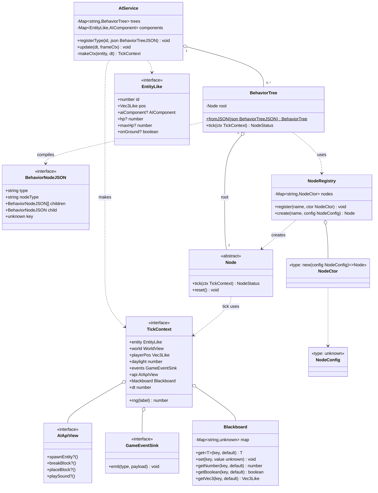
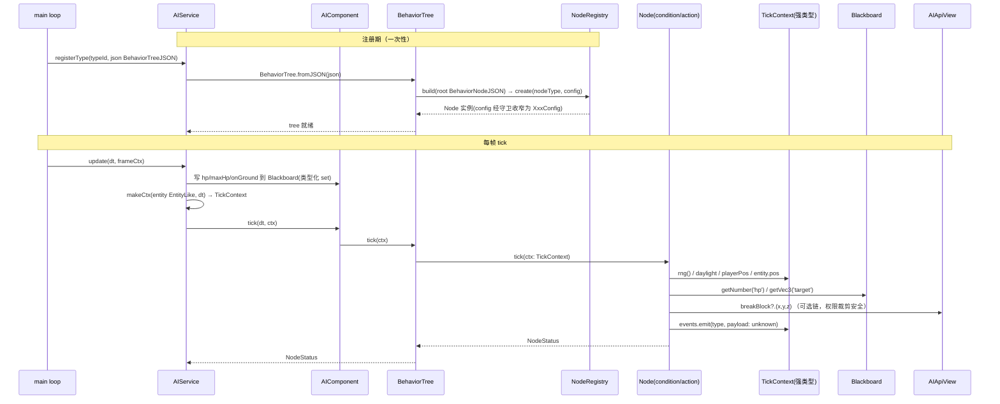
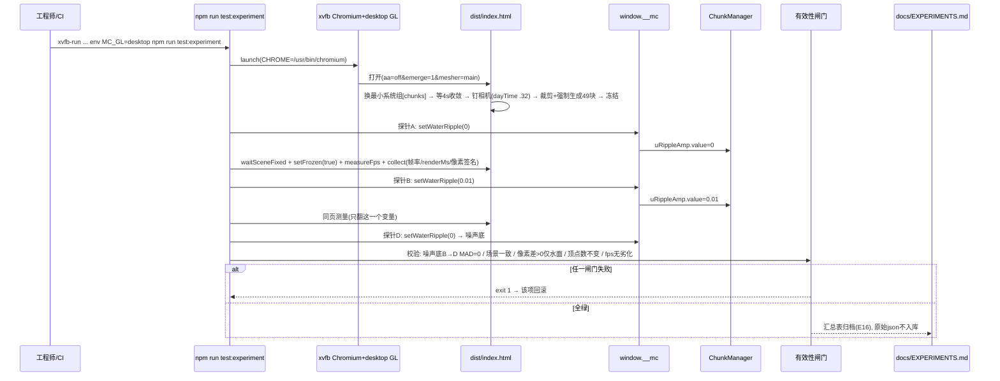
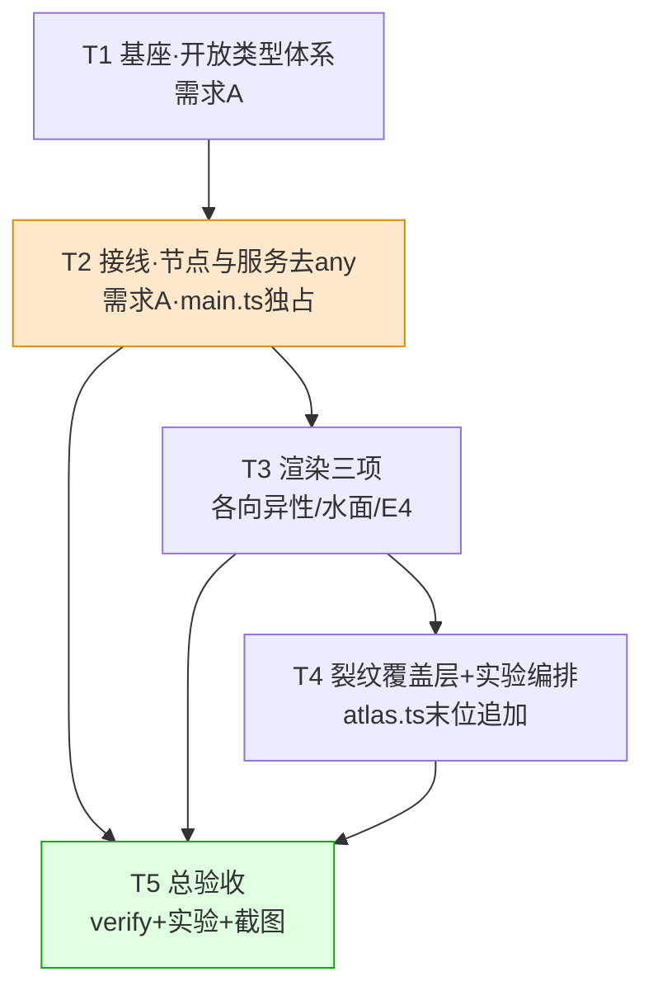

# 类型重构 + 更深画面优化（第一批 4 项）· 系统设计与任务分解

| 项 | 内容 |
|---|---|
| 语言 | 简体中文 |
| 文档类型 | 系统设计 + 有序任务分解（工程蓝图） |
| 仓库 / 基线 | `/workspace/minecraft-web-replica`，HEAD `390ce0c`（上一轮四项升级已完成并验证） |
| 架构师 | 高见远（Gao） |
| 运行时依赖 | three.js（唯一），**本轮新增依赖 0** |
| 验收 | `npm run verify` 100% PASS + eslint 0 error + 4 项画面实验前后数据 + 截图人工确认 |
| 版本 | **本轮不 bump**（`VERSION` / `RELEASE` 不动） |
| 边界 | 只写设计文档，不改 `src/` / `test/` 任何代码 |

> 本文件是实现蓝图，不含实现代码。两块需求相互独立、可分组并行；唯一共享冲突点是 `main.ts` 与 `atlas.ts`，在第 5 节任务依赖中已显式串行化。

---

## 0. 源码现状核对（设计基线，逐行确认）

| # | 事实 | 源码证据 | 设计影响 |
|---|---|---|---|
| F1 | 45 个 `no-explicit-any` 分布与盘点完全吻合：`actions.ts`15、`BehaviorTree.ts`8、`conditions.ts`8、`AIService.ts`6、`registry.ts`3、`entity.ts`1、`main.ts`4 | 逐文件 `grep -oE '\bany\b'` 统计；eslint 规则 `@typescript-eslint/no-explicit-any: error`（`eslint.config.mjs:35`） | 需求A 目标明确，45→0 可机械验证 |
| F2 | 1 个 `no-unused-vars`：`AIService.ts:5` 导入 `NodeStatus` 未使用 | `grep -n NodeStatus src/ai/AIService.ts` 仅第 5 行 import | 删除该 import 即可 |
| F3 | any 根因是**节点构造的双形态**（对象 config 或旧位置参数）+ `cfg(config:any)` + `AnyApi = {[key:string]:any}` | `actions.ts:3-8`、`conditions.ts:4-7`、各 `constructor(config: any = ...)` | 类型体系必须保留双形态兼容，用 `unknown` + 类型守卫，不能写死 |
| F4 | 工厂链 any 源头：`NodeRegistry` 的 `new (config: any) => Node`、`BehaviorTree.build(config: any)` | `registry.ts:5-14`、`BehaviorTree.ts:21,29,33,38-44,72` | 需递归 `BehaviorNodeJSON` 类型 + 类型守卫 |
| F5 | 行为树是**数据驱动**的：`behaviors/*.json`（4 张）+ `behaviors.ts` 的 `as const` 对象，字段开放（speed/dist/nodeType 等） | `src/ai/behaviors/pig.json`、`behaviors.ts:1-57`、`main.ts:240-243`（4 处 `as any`） | 类型不能封闭成穷举联合，须开放索引签名保留插件扩展 |
| F6 | `TickContext.api` 已是 `unknown`（较安全），但 `actions.ts:4` 又 cast 成 `AnyApi` | `Node.ts:30`、`actions.ts:3-4` | 用结构化 `AIApiView` 接口替代 `AnyApi` |
| F7 | `AIService` 事件类型是 `{emit:(...args:any[])=>void}`；`entity.aiComponent` 与 `comp.entity.hp/maxHp` 靠 `as any` | `AIService.ts:21,39,45,59` | `EntityLike` 加可选字段 + `GameEventSink` 接口吸收 |
| F8 | 图集 `texture.magFilter/minFilter = NearestFilter`、`generateMipmaps=false`、构造无参数 | `atlas.ts:2041,2310-2314` | **anisotropy 需 renderer 能力注入且依赖 mipmap**——见风险 R6 |
| F9 | 水面波动已有 uTime + 顶点 y 扰动（`onBeforeCompile`），但**无片元 uv 波纹**；water setter 尚不存在 | `chunkManager.ts:366-390`、setter 仅 `setDrainLimit/setFoliagePerVertex/setSphereMode`（`:553-573`） | B2 加片元 uv 扰动 + `setWaterRipple` |
| F10 | 破坏进度已在 `player.miningProgress`（0~1），HUD 已显示，**无方块裂纹覆盖层**；`BlockHighlight` 仅描边 | `player.ts:73,520-568`、`main.ts:1632`、`highlight.ts` 全文 | B3 加 10 级裂纹 tile + 覆盖层网格 + `setCracksEnabled` |
| F11 | E4 方案完整（EXPERIMENTS.md §7），但 `computeCornerLightInto` 只用 1 格 halo，边界外采样跨块 | `EXPERIMENTS.md:227-242`、`mesher.ts:187-225`（3×3 patch） | **Worker 禁 import World**（硬规则6），E4 必须走 `MeshSource` 扩展回调——见风险 R7 |
| F12 | 实验开关机制成熟：`window.__mc.chunks.setXxx` 同页翻转 + `measureT3` + 五步钉场景 + 噪声底闸门 | `experiment-3d.mjs:559-642`、`main.ts:1713-1722`（`__mc` 暴露 chunks/atlas 等） | 四项画面优化复用同一骨架，`__mc` 已暴露 atlas/chunks，新增开关挂到这两个对象即可 |
| F13 | 快照契约是 `data/sky/block` 三张 `18×80×18`，Greedy mask key 位布局固定 | 硬规则6/8、`meshTypes.ts` | E4 不得改快照尺寸与 mask key，否则破坏契约 |
| F14 | 实验正确运行方式已验证：`xvfb-run -a -s "-screen 0 1280x760x24" env MC_GL=desktop ...`，E9-E12 已跑出数据 | `EXPERIMENTS.md:420-452` | 本轮四项编号沿用 E13-E16（见 §7.4） |

**关键推论**：F8 决定各向异性不能"只设一个数"——`generateMipmaps=false` 时各向异性过滤在 WebGL 中几乎不生效，必须配套调整 `minFilter`。这是本轮最需要主理人拍板的技术点（R6）。F11 决定 E4 不能直接在 mesher 里读 `World`，否则破坏 Worker 解耦硬规则。

---

## 1. 实现方案总览

### 1.1 两块需求的策略

**需求A（类型重构）——"建立开放类型基座，逐层替换 any，保持数据驱动"**

- 不写死类型：核心是 `NodeConfig = unknown` + 类型守卫（`isRecord` / `num` / `str`），每个节点定义自己的 `XxxConfig` 接口，构造函数用**重载签名**保留双形态（对象 config / 位置参数）。
- 工厂链用**递归的 `BehaviorNodeJSON` 开放结构**（`type: string` + `[key: string]: unknown`），既覆盖内置 selector/sequence/condition/action，也允许插件自定义 `nodeType`，JSON 与 `as const` 对象都能通过。
- `unknown` 优先于 `any`，泛型约束优先于断言；仅在与外部受信 API 交界处用带字段的接口（`AIApiView` / `GameEventSink`）。

**需求B（画面优化）——"务实增量，每项一个同页开关，逐项受控实验"**

- 四项全部挂到既有 `__mc` 调试对象（`atlas` / `chunks`），复用 `test/experiment-3d.mjs` 的五步钉场景与 `measureT3` 骨架。
- 每项独立开关、独立 A/B arm、独立噪声底；任一项数据不达标即单独回滚，不捆绑。
- 不碰引擎内核：不改 Worker 消息协议主体、不改快照三缓冲、不改方块 id、不改图集既有 tile 索引。

### 1.2 分批与并行关系

| 批次 | 任务 | 需求 | 并行性 |
|---|---|---|---|
| 批 1 | T1 AI 类型基座与工厂链 | A | 与批 1 的 B 组无文件冲突，可并行 |
| 批 1 | T2 节点实现与服务接线去 any | A | 依赖 T1；**独占 `main.ts` 前段（4 行）**，须先于需求B的 `main.ts` 改动 |
| 批 2 | T3 渲染管线三项（各向异性 / 水面波纹 / E4） | B | 依赖 T2（`main.ts` 串行）；内部三项可逐项实现但共享 `chunkManager.ts`/`main.ts` |
| 批 2 | T4 破坏裂纹覆盖层 + 实验编排 | B | 依赖 T3（`atlas.ts`/`main.ts` 串行）；含实验脚本 4 arm |
| 批 3 | T5 总验收 | A+B | 唯一出口，依赖 T2/T3/T4 |

**并行边界结论**：需求A 的 T1 可与需求B 的**设计/实验脚本准备**并行；但 `main.ts`（A 的 4 行 + B 的开关接线）与 `atlas.ts`（B 的两项）是硬串行点，由 T2→T3→T4 顺序消化。建议分派：工程师甲做需求A（T1→T2），工程师乙并行做实验脚本与图集纹理准备，待 T2 合入后乙再落 `main.ts`/`atlas.ts` 改动。

---

## 2. 改动分区表

| 相对路径 | 改动类型 | 所属层 | 改动要点 | 任务 |
|---|---|---|---|---|
| `src/ai/types.ts` | **新增** | AI 层（类型） | `NodeConfig`/`BehaviorNodeJSON`/`AIApiView`/`GameEventSink`/`Vec3Like` 等开放类型 + 类型守卫 `isRecord/num/str/optNum` | T1 |
| `src/ai/Node.ts` | 修改 | AI 层（类型） | `TickContext.api: AIApiView`；`events: GameEventSink`；新增 `NodeConfig` 导入；`Node` 基类可保留非泛型（`tick(ctx)` 与 config 无关） | T1 |
| `src/ai/Blackboard.ts` | 修改（轻） | AI 层（数据） | 增加可选 `getNumber/getBoolean/getVec3` 类型化读取（内部仍 `get<T>`），供节点免 cast | T1 |
| `src/ai/registry.ts` | 修改 | AI 层（工厂） | `Map<string, NodeCtor>`；`NodeCtor = new (config: never) => Node` 或 `new (config: unknown) => Node`；`create(name, config: NodeConfig)` | T1 |
| `src/ai/BehaviorTree.ts` | 修改 | AI 层（工厂） | 内建注册表元组类型改为 `readonly [string, NodeCtor][]`，去掉两处 `as [string, new(config:any)=>Node][]`；`build(config: BehaviorNodeJSON, ...)`；`fromJSON(json: BehaviorTreeJSON)` | T1 |
| `src/ai/conditions.ts` | 修改 | AI 层（节点） | 8 个 `config: any` → 各 `XxxConfig` + 双形态重载；`cfg<T>` 改为 `unknown` + 守卫 | T2 |
| `src/ai/actions.ts` | 修改 | AI 层（节点） | 15 个 any（含 `AnyApi`）→ `AIApiView` + 各 `XxxConfig` 双形态重载；`SpawnEntity.offset?: any` → `Vec3Like` | T2 |
| `src/ai/AIService.ts` | 修改 | AI 层（服务） | 删 `NodeStatus` 未用 import；`events: GameEventSink`；`registerType/reloadConfig(json: BehaviorTreeJSON)`；`aiComponent`/`hp/maxHp/onGround` 经 `EntityLike` 可选字段消除 `as any` | T2 |
| `src/ai/AIComponent.ts` | 修改（轻） | AI 层（数据） | `EntityLike` 增补可选 `aiComponent?` / `hp?` / `maxHp?` / `onGround?`，作为 AIService 与 entity 的共享结构类型 | T2 |
| `src/main.ts` | 修改 | 组装根 | ①T2：4 处 `as any` → 去掉（`registerType` 接受 `BehaviorTreeJSON`）；②T3：`__mc.atlas.setAnisotropy` 暴露 + renderer 能力注入；③T4：`setCracksEnabled` 接线、`highlight` 按 `miningProgress` 更新 | T2/T3/T4（串行） |
| `src/entity/entity.ts` | 修改 | 实体层 | `:366` `detach?.(e as any)` → `e` 满足 `EntityLike`，去掉断言（与需求B无冲突） | T2 |
| `src/gfx/atlas.ts` | 修改 | 渲染层 | ①T3：`setAnisotropy(max: number, level: number)`，配合 `minFilter` 决策；②T4：追加 10 级裂纹 tile painter（**末位追加**，不改既有 tile 索引）；`generateMipmaps` 按 R6 决策 | T3/T4（串行） |
| `src/world/chunkManager.ts` | 修改 | 渲染层 | B2：water 片元 uv 波纹 + `uRippleAmp` uniform + `setWaterRipple`；B4：`MeshConfig.boundaryLightFix` + `setBoundaryLightFix`；`__mc.chunks` 暴露新 setter（已暴露对象，加方法即可） | T3 |
| `src/world/mesher.ts` | 修改 | 数据层（Worker 共享） | E4：`computeCornerLightInto` 越过边界时走 `src.crossChunkLight?.(x,y,z,channel)` 可选回调；**不 import World** | T3 |
| `src/world/meshTypes.ts` | 修改（轻） | 数据层（契约） | `MeshSource` 增可选只读回调 `crossChunkLight?`；`MeshConfig` 增 `boundaryLightFix: boolean`；快照三缓冲尺寸与 mask key **不动** | T3 |
| `src/gfx/highlight.ts` | 修改 | 渲染层 | 破坏裂纹覆盖层：`setCrack(level, hit)` / `setEnabled(bool)`，10 级裂纹 tile 贴图 + 6 面覆盖网格 | T4 |
| `test/experiment-3d.mjs` | 修改 | 测试 | 新增 E13-E16 四个 A/B arm（复用 `measureT3`/五步钉场景），每 arm 含噪声底 B→D 与场景一致性闸门 | T4 |
| `test/ai-check.cjs` | 修改（按需） | 测试 | 补：类型重构后行为树 JSON 数据驱动等价（4 张 behaviors 编译 + tick 状态一致）；节点双形态构造等价 | T2 |
| `test/mesher-check.cjs` | 修改（按需） | 测试 | E4 边界光：边界方块角点采样走新回调的确定性断言；顶点字节/面覆盖不变 | T3 |
| `test/visual-check.mjs` | 修改（按需） | 测试 | 破坏裂纹 10 级 tile 存在性与既有 tile 索引不变断言 | T4 |
| `docs/EXPERIMENTS.md` | 修改 | 文档 | §7 E4 落地结论；新增 E13-E16 假设/对照/翻转/判据/实测数据；未关闭闸门如实记录 | T3/T4/T5 |
| `docs/ARCHITECTURE.md` | 修改（按需） | 文档 | §8.7 补 AI 类型体系；§8.3 补四项画面优化入口 | T5 |
| `docs/TESTING.md` | 修改（按需） | 文档 | `test:ai`/`test:mesher` 新增断言说明 | T5 |
| `docs/superpowers/plans/2026-11-22-typerefactor-visual-deep-design.md` | 本文件 | 文档 | 设计蓝图 | — |

**明确不改动**：`scripts/build-test-snapshot.mjs`（无新纯逻辑入口）、`src/core/version.ts`（不 bump）、`src/world/blocks.ts` / `src/player/survival.ts`（无新方块/item）、`test/logic/` / `test/terrain-logic/` / `dist/` / `test/artifacts/`（不入库）。

### 2.1 硬规则守护映射

| 硬规则 | 本轮守护方式 |
|---|---|
| 1 版本双轨 | 不 bump，`VERSION`/`RELEASE` 不动 |
| 2 方块 id 只追加 | 裂纹是**纹理 tile**不是方块，不占 id；不新增方块 |
| 3/4 配置表 + 数据/渲染解耦 | AI 类型纯类型层；E4 走 `MeshSource` 回调，Worker **不 import three/World** |
| 5 Worker 配置失效 | `MeshConfig.boundaryLightFix` 变更走既有 `invalidateConfig()` + `postConfig()` + ACK 链路，`configReady` 判据不变 |
| 6 快照契约 | 三张 `18×80×18` 尺寸不变、mask key 不变；E4 不改快照字段 |
| 7/14 受控实验 | 四项各同页 A/B + 噪声底=0 + 场景一致性闸门 |
| 8 Worker 池回退 | 不动构造逻辑 |
| 13 诊断不变量 | 如新增 `boundaryLightFix` 配置态，可在 `RuntimeDiagnostics` 加只读检查（可选） |
| 15 大二进制不入库 | 截图 WebP ≤1MB 入 `docs/assets/`，原始 `test/artifacts/` 不入库 |

---

## 3. 数据结构与接口

### 3.1 需求A：AI 类型体系（TypeScript 接口契约）

**设计原则**：开放优先（`[key: string]: unknown` + `type: string`），双形态兼容（重载），守卫收窄（不用断言），`unknown` 替代 `any`。

```ts
// src/ai/types.ts（新增）——全部为纯类型 + 纯守卫，零运行时依赖

/** 节点 config 统一入口：JSON 对象、历史位置参数、插件自定义对象都能装进来 */
export type NodeConfig = unknown;

export type isRecord = (v: unknown) => v is Record<string, unknown>;
export const isRecord: isRecord = (v): v is Record<string, unknown> =>
  typeof v === 'object' && v !== null && !Array.isArray(v);
export const num = (v: unknown, fallback: number): number =>
  typeof v === 'number' && Number.isFinite(v) ? v : fallback;
export const str = (v: unknown, fallback: string): string =>
  typeof v === 'string' ? v : fallback;
export const optNum = (v: unknown): number | undefined =>
  typeof v === 'number' && Number.isFinite(v) ? v : undefined;
export const vec3 = (v: unknown, fallback: Vec3Like): Vec3Like =>
  isRecord(v) ? { x: num(v.x, 0), y: num(v.y, 0), z: num(v.z, 0) } : fallback;

export interface Vec3Like { x: number; y: number; z: number }

/** 受限 API 视图：只列节点实际用到的副作用入口，全部可选（权限裁剪后可能不存在） */
export interface AIApiView {
  spawnEntity?(typeId: string, offset: Vec3Like, chance: number): unknown;
  breakBlock?(x: number, y: number, z: number): unknown;
  placeBlock?(x: number, y: number, z: number, blockId: number): unknown;
  playSound?(sound: string, volume: number): unknown;
}

/** 事件出口：与 GameEvents 的安全子集对齐，key 开放，payload 用 unknown */
export interface GameEventSink {
  emit<K extends string>(type: K, payload: unknown): void;
}

/**
 * 行为树 JSON 的递归开放结构。
 * - 内置控制/装饰器节点靠 type 分派
 * - condition/action 靠 nodeType 交由 NodeRegistry 工厂，特有字段走 [key:string]: unknown
 * - 不写穷举联合，插件自定义 nodeType 天然可注入，数据驱动能力不丢
 */
export interface BehaviorNodeJSON {
  type: string;                    // selector|sequence|parallel|randomSelector|inverter|repeater|until_fail|until_success|condition|action
  name?: string;
  nodeType?: string;               // condition/action 用
  children?: BehaviorNodeJSON[];   // 控制节点
  child?: BehaviorNodeJSON;        // 装饰器
  [key: string]: unknown;          // 开放扩展位：speed/dist/damage/offset 等特有参数
}
export interface BehaviorTreeJSON { root: BehaviorNodeJSON }

/** 节点构造签名：config 用 unknown，具体节点在自身 file 内定义 XxxConfig 并守卫收窄 */
export type NodeCtor = new (config: NodeConfig) => Node;
```

**各节点 config 示例（保持双形态）**：

```ts
// src/ai/conditions.ts / actions.ts 内，每个节点一段
export interface ChasePlayerConfig {
  speed?: number; stopDist?: number; speedFar?: number; speedClose?: number; closeDist?: number;
}
export class ChasePlayer extends Node {
  constructor(config?: ChasePlayerConfig | number, stopDist?: number);  // 重载：对象 或 旧位置参数
  constructor(config: NodeConfig = {}, stopDist?: number) {
    super();
    if (isRecord(config)) {                       // 守卫收窄，不再 as any
      this.speed = num(config.speed, 1);
      this.stopDist = num(config.stopDist, 2);
      this.speedFar = optNum(config.speedFar);
      // ...
    } else {
      this.speed = num(config, 1);                // 历史位置参数：config 是 number
      this.stopDist = stopDist ?? 2;
    }
  }
}
```

**类型关系图（Mermaid classDiagram）**：



**类型守卫的正当性**：与受信 API（`ctx.api`、`ctx.events`）交界处用结构化接口（`AIApiView`/`GameEventSink`）而非 `any`，既满足 eslint，又保留"未声明写能力时方法不存在"的权限语义（`?.` 调用自然降级）。

### 3.2 需求B：四项开关的 uniform / 参数设计

#### B1 各向异性过滤（E13）

| 项 | 设计 |
|---|---|
| 常量来源 | `MAX_ANISO_HINT = 8`；实际上限 `min(MAX_ANISO_HINT, renderer.capabilities.getMaxAnisotropy())` |
| 接口 | `atlas.setAnisotropy(level: number): void`——内部 `this.texture.anisotropy = clamp(level,1,max)` + `needsUpdate=true` |
| 配套决策（R6） | 需配合 `minFilter`：`NearestMipmapNearestFilter` + `generateMipmaps=true` 时各向异性生效且**放大仍保持 Nearest 像素锐利**；`magFilter` 恒为 `NearestFilter` 不动 |
| 翻转 | `page.evaluate(() => __mc.atlas.setAnisotropy(off ? 1 : max))`，同页 A→B→D |
| 判据 | 像素签名 MAD > 0（远景斜视纹理有变化，证明生效）；噪声底 B→D=0；近景正视像素差=0（像素风不糊）；fps 不显著劣化 |

#### B2 水面像素波纹（E14）

| 项 | 设计 |
|---|---|
| uniform | `uRippleAmp`（float，默认 0；开启建议 0.006~0.012），与既有 `uTime` 共用 |
| 注入位置 | `chunkManager.ts:379` 的 water `onBeforeCompile` 片元段：在 `#include <map_fragment>` 后对 `vMapUv` 叠加 `sin/cos(wxz*freq + uTime*speed) * uRippleAmp` |
| 接口 | `chunks.setWaterRipple(amp: number): void`——写 `this.waterRipple.value` 并标记材质 `needsUpdate`（仅在从 0 切换时需重编译，幅度变化只改 uniform） |
| 冻结兼容 | 扰动相位由 `uTime`（`waterTime`）驱动，实验冻结时归零，保证 A/B 同帧可比 |
| 翻转 | 同页 A(0)→B(amp)→D(0) |
| 判据 | 像素差 MAD > 0 且集中在水面；噪声底=0；draw calls / 顶点数不变；fps 无显著劣化 |

> 注意：B2 是**片元 uv 扰动**，与既有 `:388` 的顶点 y 扰动互补；两者共存，实验只翻 `uRippleAmp`，顶点扰动保持每一档相同以隔离变量。

#### B3 破坏裂纹覆盖层（E15）

| 项 | 设计 |
|---|---|
| tile 归属 | `atlas.ts` 追加 10 个 painter：`crack_0` … `crack_9`（16×16，裂纹由少到密）。**末位追加**，既有 tile 索引不变；不占方块 id |
| 覆盖层网格 | `BlockHighlight` 增 `crackMesh: THREE.Mesh<BoxGeometry(1.01³), MeshBasicMaterial>`，`transparent+depthWrite:false`，`renderOrder=5`（高于描边 4） |
| 接口 | `highlight.setCrack(level: number, hit: {x,y,z} | null)`、`highlight.setCracksEnabled(bool)`；`level = floor(miningProgress*10)`，0 表示无裂纹 |
| 接线 | `main.ts:1623-1633` 附近：把 `player.miningProgress` 与 `player.miningBlock` 喂给 `highlight.setCrack`；`__mc.highlight` 暴露开关（若无则在 `__mc` 增加 `highlight` 引用） |
| 纹理映射 | 覆盖层材质用图集，`uv` 固定指向当前等级 `crack_N` 的 tile；用 `onBeforeCompile` 或每级换 `map.offset`（推荐 uniform `uCrackOrigin` 避免 10 个材质） |
| 翻转 | 同页 A(enabled=false)→B(true)→D(false)；`level` 固定在 5（ digging 中态）便于复现 |
| 判据 | 10 级 tile 存在且既有 tile 索引不变（`test:visual`）；开关前后像素差>0 且仅在准星方块；噪声底=0；破坏完成/取消后覆盖层正确消失 |

#### B4 区块边界光晕接缝 E4（E16）

| 项 | 设计 |
|---|---|
| 开关 | `MeshConfig.boundaryLightFix: boolean`（默认 false=现状），`chunks.setBoundaryLightFix(bool)` 经既有 `invalidateConfig()` + `postConfig()` + ACK 链路下发；`configReady` 判据不变 |
| 数据通道 | `MeshSource` 增**可选只读回调** `crossChunkLight?(x: number, y: number, z: number, channel: 'sky' \| 'block'): number`（世界坐标） |
| 主线程实现 | `WorldMeshSource` 提供回调：`world.getSkyLight/getBlockLight(x,y,z)`（真实邻块值） |
| Worker 实现 | `SnapshotMeshSource` 提供回调：基于 1 格 halo 已有光照对越界坐标**外推/clamp**（**不 import World**）；A/B 实验统一在 `?mesher=main` 路径验证 E4 真实效果，Worker 路径只保证同源 mesher 不崩、结构等价（`test:mesher`） |
| mesher 改动 | `computeCornerLightInto` 采样 `(x,y,z)` 时若越出本区块，优先调 `src.crossChunkLight?.(...)`，否则维持原 `getSkyLight/getBlockLight` 行为 |
| 快照/mask | 三缓冲尺寸 `18×80×18` 不变，Greedy mask key 位布局不变（硬规则 6/8） |
| 翻转 | 同页 A(false)→B(true)→D(false)，`?mesher=main` 固定路径 |
| 判据 | `test:mesher` 全绿；顶点数/draw calls/programs 不变；像素差在噪声底内或接缝暗纹消失（截图人工确认）；**重网格化成本增幅需量化**（EXPERIMENTS.md §6 警告"成本成倍放大"），超阈值即回滚 |

---

## 4. 程序调用流程

### 4.1 时序图①：行为树 tick 的类型流（重构后）



**类型流要点**：`BehaviorTreeJSON`（开放结构）→ `NodeConfig=unknown` → 守卫收窄为各 `XxxConfig` → 节点字段确定类型；`ctx.api` 从 `unknown` 收敛为 `AIApiView`；`ctx.events` 收敛为 `GameEventSink`；黑板读取收敛为 `getNumber/getVec3`。全链路无 `any`，且 JSON 数据驱动与插件 nodeType 扩展保持不变。

### 4.2 时序图②：一次画面 A/B 受控实验流（以 B2 水面波纹为例）



---

## 5. 任务列表（核心产物 · 有序、带依赖、按实现顺序）

> 需求A 与需求B 分组并行，但 `main.ts` / `atlas.ts` 为硬串行点，已由 T2→T3→T4 顺序消化。每任务含编号/标题/涉及文件/前置依赖/验收判据/可并行标记。

| 编号 | 标题 | 涉及文件 | 前置依赖 | 验收判据 | 可并行 |
|---|---|---|---|---|---|
| **T1** | 【A·基座】AI 开放类型体系与工厂链去 any | `src/ai/types.ts`(新增)、`Node.ts`、`Blackboard.ts`、`registry.ts`、`BehaviorTree.ts` | 无 | ①`NodeConfig=unknown` 与守卫就位，`registry.ts` 3 个 any、`BehaviorTree.ts` 8 个 any 归零；②`BehaviorNodeJSON` 开放结构覆盖 4 张 behaviors JSON 与 `behaviors.ts` 的 `as const` 对象；③`npm run typecheck` 0 error；④`npm run test:ai` 全绿、行为树 tick 状态与重构前逐值一致 | 是（与需求B准备阶段无文件冲突） |
| **T2** | 【A·接线】节点实现、服务层与调用方去 any（AI 债务清零） | `src/ai/conditions.ts`、`src/ai/actions.ts`、`src/ai/AIService.ts`、`src/ai/AIComponent.ts`、`src/main.ts`(4 行)、`src/entity/entity.ts`(1 行) | T1 | ①`conditions.ts`8 + `actions.ts`15 + `AIService.ts`6 + `main.ts`4 + `entity.ts`1 + NodeStatus unused 全部清零；②`npm run lint` 与 `npm run lint:eslint` 均 0 error（45 any + 1 unused = 0）；③`test:ai`/`test:services` 全绿；④双形态构造兼容（对象 config 与位置参数均通过）；⑤**先于需求B完成 `main.ts` 改动**，避免同文件冲突 | 否（`main.ts` 独占，须先于 T3/T4） |
| **T3** | 【B·渲染】各向异性 + 水面波纹 + E4 边界光（三项同页开关） | `src/gfx/atlas.ts`、`src/world/chunkManager.ts`、`src/world/mesher.ts`、`src/world/meshTypes.ts`、`src/main.ts`(初始化+__mc) | T2（`main.ts` 串行） | ①三 setter 就位：`atlas.setAnisotropy`、`chunks.setWaterRipple`、`chunks.setBoundaryLightFix`；②E4 走 `MeshSource.crossChunkLight` 回调，**Worker 侧无 three/World import**（grep 验证）；③`MeshConfig.boundaryLightFix` 经 invalidateConfig+ACK 链路，`configReady` 判据不变；④快照三缓冲尺寸与 mask key 不变；⑤`test:mesher` 全绿、`verify` 相关组通过；⑥三项各产出同页 A/B 数据（可并入 T4 脚本） | 否（`main.ts`/`chunkManager.ts` 共享） |
| **T4** | 【B·裂纹+编排】破坏裂纹覆盖层 + 四项实验脚本与数据 | `src/gfx/highlight.ts`、`src/gfx/atlas.ts`(10 tile 末位追加)、`src/main.ts`(progress 接线+__mc)、`test/experiment-3d.mjs`、`test/visual-check.mjs`、`docs/EXPERIMENTS.md` | T3（`atlas.ts`/`main.ts` 串行） | ①10 级 `crack_N` tile 末位追加、**既有 tile 索引与方块 id 契约不变**（`test:visual` 断言）；②`highlight.setCrack/setCracksEnabled` 接线 `player.miningProgress`，破坏完成/取消正确消失；③`test:experiment` 新增 E13-E16 四 arm，每 arm 含噪声底=0、场景一致性、像素判据闸门；④4 项前后数据齐全写入 EXPERIMENTS.md，未达标项如实记录回滚 | 否（`atlas.ts`/`main.ts` 串行） |
| **T5** | 【总验收】verify + eslint + 4 项实验数据 + 截图人工确认 | `docs/EXPERIMENTS.md`(汇总)、`docs/ARCHITECTURE.md`、`docs/TESTING.md`、`test/artifacts/*`(不入库)、`docs/assets/*.webp`(≤1MB) | T2、T3、T4 | ①`npm run verify` 100% PASS（含版本/lint/tsc/构建/全部回归/浏览器实景）；②eslint `no-explicit-any` 与 `no-unused-vars` 均 0；③E13-E16 四项前后数据齐全、噪声底=0、无劣化项；④4 项画面同视角截图经主理人确认"有实质改进无退化"；⑤不 bump 版本、不提交 >1MB 二进制、原始产物不入库 | 否（唯一出口） |

### 5.1 依赖图（Mermaid）



**分派建议**：工程师甲领 T1→T2（需求A）；工程师乙并行准备实验脚本骨架与图集 painter 设计，但 **T3/T4 的 `main.ts`/`atlas.ts` 改动须等 T2 合入后**开始。T5 由主理人主持验收。注意 T2 与 T3 之间、`atlas.ts` 在 T3 与 T4 之间均为硬串行，禁止并行改同一文件。

---

## 6. 依赖包清单（确认新增 0）

| 现有依赖 | 版本 | 本轮用途 |
|---|---|---|
| `three` | 0.170.0 | 唯一运行时依赖；anisotropy 常量、覆盖层网格、uniform 注入均用现有 API |
| `puppeteer-core` | ^23.11.1 | 受控实验（已验证 xvfb + desktop GL 可用） |
| `typescript` / `eslint` / `@typescript-eslint/*` / `biome` / `vitest` | 锁定 | 类型守卫与 eslint 门禁用现有工具链，不新增 |

**结论**：`package.json` 零改动。新增 `src/ai/types.ts` 是纯类型文件，不引入任何依赖；`getMaxAnisotropy()` 是 three.js `WebGLRenderer.capabilities` 的既有方法。

---

## 7. 共享知识 / 跨文件约定

### 7.1 类型约定（需求A）

- **禁 `any`**：新代码一律 `unknown` + 类型守卫（`isRecord`/`num`/`str`/`vec3`）或泛型约束；仅在受信 API 边界用结构化接口 `AIApiView`/`GameEventSink`。
- **开放而非穷举**：`BehaviorNodeJSON` 用 `type: string` + `[key:string]: unknown`，插件 `nodeType` 可自由注册；不要改成封闭联合。
- **双形态兼容**：节点构造函数保留"对象 config / 位置参数"重载，既有行为树与测试调用不破坏。
- `Node` 基类**不泛型化**：config 只在构造期消费，`tick(ctx)` 对所有节点同签名，泛型化会污染 `NodeRegistry`/`BehaviorTree`，收益为负。
- eslint 下划线前缀豁免未使用变量（`eslint.config.mjs:36`），真正的 unused（如 `NodeStatus` import）直接删除。

### 7.2 画面约定（需求B）

- 四个开关命名固定：`setAnisotropy` / `setWaterRipple` / `setBoundaryLightFix` / `setCracksEnabled`，均挂 `__mc.atlas` 或 `__mc.chunks`/`__mc.highlight`，供实验脚本同页翻转。
- 实验编号：**E13 各向异性、E14 水面波纹、E15 破坏裂纹、E16 边界光**（E9-E12 已被上一轮性能四项占用，见 EXPERIMENTS.md §9）。
- 每项 A/B 必须在**同页**翻转、先证场景一致、**噪声底 B→D=0**；单项不达标单独回滚。
- 图集纪律：裂纹 tile 末位追加，既有索引不变；方块 id 不新增。
- 冻结场景：水面波纹相位随 `waterTime`，实验冻结时归零；E4 实验固定 `?mesher=main` 路径以隔离 Worker 近似实现的干扰。

### 7.3 测试入口

1. `npm run typecheck` 基线干净 → 改动 → `npm run test:snapshot` → `test:ai`/`test:services`/`test:mesher`/`test:visual`。
2. 类型债务机械验证：`npm run lint`（biome）+ `npm run lint:eslint`（eslint max-warnings 0）必须 0 error。
3. 画面实验：`npm run build` 后 `xvfb-run -a -s "-screen 0 1280x760x24" env MC_HEADLESS=0 MC_GL=desktop npm run test:experiment`（不挂 verify）。
4. 唯一验收入口：`npm run verify` 100% PASS。

### 7.4 Git 提交边界

- 入库：`src/**`、`test/*.cjs`/`*.mjs`、`docs/**`。
- 不入库：`test/logic/`、`test/terrain-logic/`、`dist/`、`test/artifacts/`（实验原始 json/截图）；大图转 WebP ≤1MB 后入 `docs/assets/`。
- 一次只合一个 PR，绿了再下一个；本轮不 bump 版本，无需版本-断言同 commit。

---

## 8. 风险与待明确事项

| # | 风险 | 影响 | 缓解方案 | 架构结论 |
|---|---|---|---|---|
| R1 | 类型重构破坏行为树数据驱动 | JSON 配置编译失败、插件 nodeType 失效、tick 行为漂移 | `BehaviorNodeJSON` 用开放结构 + 索引签名；双形态构造重载；T1/T2 各跑 `test:ai` 与 4 张 behaviors 编译 + tick 逐值对比 | 开放类型基座是硬要求，禁止写死穷举联合 |
| R2 | 双形态构造重载写错导致历史调用点崩 | 直接 `new ChasePlayer(1.5)` 等位置参数调用失效 | 每个节点保留两签名重载 + `isRecord` 分流；测试覆盖两种形态 | 兼容优先于简洁 |
| R3 | `unknown` 守卫遗漏导致 eslint 仍报 any 或行为错 | 目标 unmet / 运行时 NaN | 集中守卫工具于 `types.ts`；`num/str/vec3` 带 fallback；逐文件 grep any 复核 | 45 any + 1 unused 必须归零，机械验收 |
| R4 | `main.ts`/`atlas.ts` 同文件冲突 | 需求A与B并行改同一文件产生 merge 冲突 | T2 先完成 `main.ts` 4 行；T3/T4 串行接手；T3 先改 `atlas.ts` 构造/anisotropy，T4 再追加裂纹 tile | 硬串行，禁止并行改同文件 |
| R5 | 破坏裂纹 tile 影响 id 契约 | 若误加方块或插队 tile，旧存档错乱 | 裂纹仅为图集末位 painter，不碰 `blocks.ts`/id；`test:visual` 断言既有 tile 索引不变 | 零新增方块、零插队 tile |
| R6 | **各向异性与像素风冲突 + 设备差异** | `generateMipmaps=false` 时 anisotropy 几乎无效；开 mipmap 有糊化风险；海内外设备 `getMaxAnisotropy()` 上限不同（移动 GPU 常为 2/4，桌面 8/16） | 保持 `magFilter=Nearest`（放大锐利不变），仅 `minFilter=NearestMipmapNearestFilter` + `generateMipmaps=true` 让缩小时的 anisotropy 生效；level 取 `min(8, 设备上限)`；实验在 SwiftShader（上限可能低）如实记录，真机数据另采 | **需主理人拍板 minFilter 方案**；否则 B1 可能"设了但无效果"。这是本轮最高不确定项 |
| R7 | **E4 边界光放大成本 + Worker 解耦冲突** | EXPERIMENTS.md §6 警告"修它会把重网格化成本成倍放大"；Worker 禁 import World，无法直接读邻块 | 走 `MeshSource.crossChunkLight` 可选回调；主线程用 world，Worker 用 halo 外推；实验固定 `?mesher=main` 验证效果，Worker 只保证同源不崩；**量化重网格化耗时增幅，超阈值即回滚** | E4 本质是"修复尝试"，成本不可接受就回滚，不勉强合并 |
| R8 | 水面 uv 扰动破坏冻结/噪声底 | A/B 两帧相位不同导致噪声底≠0，数据作废 | 扰动相位全部走 `uTime=waterTime`，冻结时归零；先测噪声底再下结论 | 相位统一由 uTime 驱动，禁用独立时间源 |
| R9 | 覆盖层遮挡/深度穿帮 | 裂纹覆盖描边或穿透方块 | 几何 1.01³ 略大于描边 1.006³，`depthWrite:false`、`renderOrder=5`，`transparent`；截图人工确认 | 覆盖层只贴准星方块，破坏完成即隐藏 |
| R10 | 实验帧率在 SwiftShader 下噪声大 | 绝对帧率不可信 | 只依赖同页翻转差值与噪声底=0；跨次浮动如实标注 | 与既有实验口径一致 |

### 8.1 待主理人拍板（不阻塞 T1/T2 开工）

| 项 | 说明 | 架构建议 |
|---|---|---|
| R6 minFilter 方案 | 是否接受 `NearestMipmapNearestFilter` + `generateMipmaps=true` 作为"务实折中"？（用户已排除"安全mipmap 高风险糊化"方案，但 NearestMipmapNearest 只作用于缩小、放大仍 Nearest） | 建议采纳并先在实验里看近景像素差；若近景仍糊则回滚 B1 |
| R7 E4 是否值得做 | 若实测重网格化 cost 增幅 >50% 或接缝改善不明显 | 建议回滚 E4，其余三项照常交付 |
| 实验编号 | E13-E16 沿用确认 | 与 §7.2 一致即可 |
| 未关闭闸门 | 上一轮 E3 自发光 1 采样点差异、MSAA 跨页 parity 未闭环（EXPERIMENTS.md §9） | 本轮不处理，T5 验收时如实记录，不伪造通过 |

---

## 附录 A · 逐任务检查清单

- [ ] T1：types.ts 开放类型 → registry/BehaviorTree 8+3 any 归零 → 4 张 behaviors 编译 → test:ai 绿
- [ ] T2：conditions/actions/AIService/main/entity 的 34 any + 1 unused 归零 → eslint 0 error → 双形态兼容测试 → main.ts 交接
- [ ] T3：三 setter → E4 走 MeshSource 回调且 Worker 无 three/World → config ACK 链路 → test:mesher 绿 → 快照/mask 不变
- [ ] T4：10 tile 末位追加 → 裂纹覆盖层接线 → E13-E16 四 arm + 噪声底闸门 → 数据入档
- [ ] T5：verify 100% → eslint 0 → 四项数据 → 截图人工确认 → 不入库清理

## 附录 B · 验收对照表（QA 用）

| 件套 | 判据 | 输出物 |
|---|---|---|
| verify 100% | `npm run verify` 全绿（含 lint/tsc/build/30+ 组/浏览器实景） | CI/本地日志 |
| 类型债务清零 | eslint `no-explicit-any`=0、`no-unused-vars`=0；行为树数据驱动等价 | eslint 输出 + test:ai |
| 4 项画面数据 | E13-E16 各 A/B 前后数据、噪声底=0、无劣化项 | `docs/EXPERIMENTS.md` 汇总表（入库），原始 json 不入库 |
| 截图确认 | 4 项画面同视角前后（含 E4 接缝、裂纹 10 级） | `docs/assets/*.webp`（≤1MB，入库），原图 `test/artifacts/`（不入库） |
