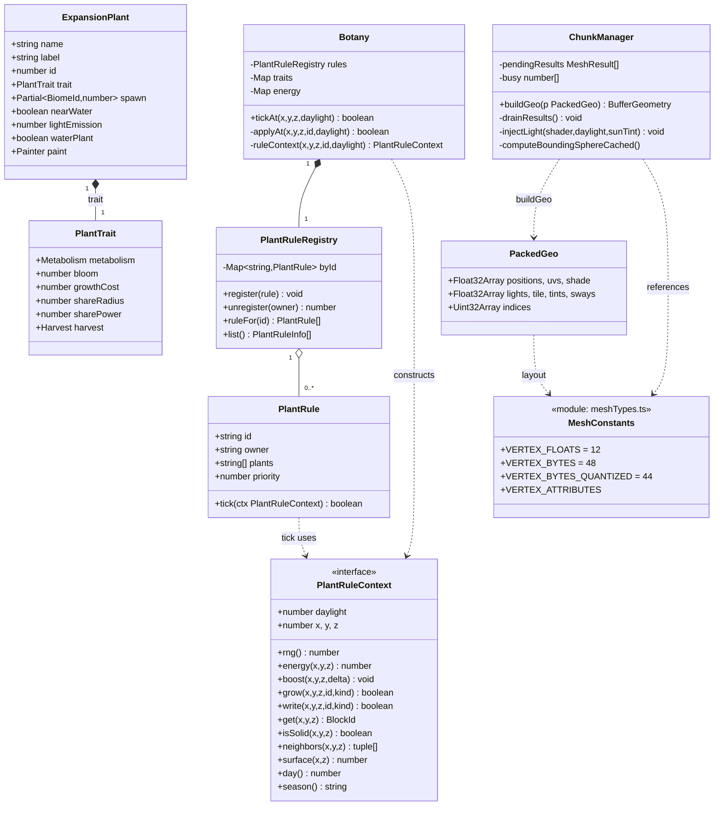
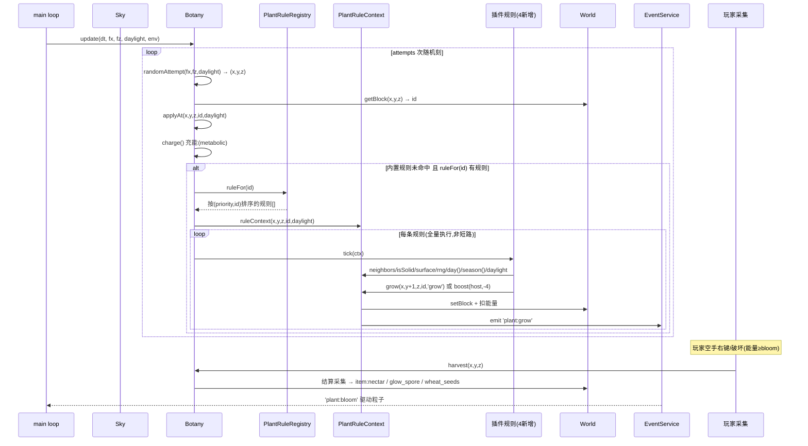
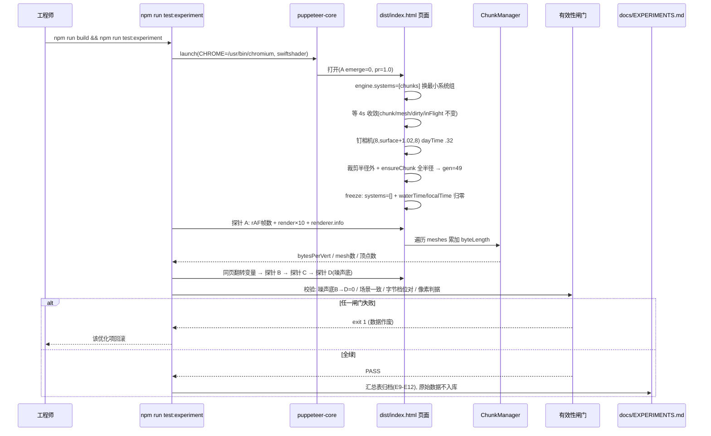
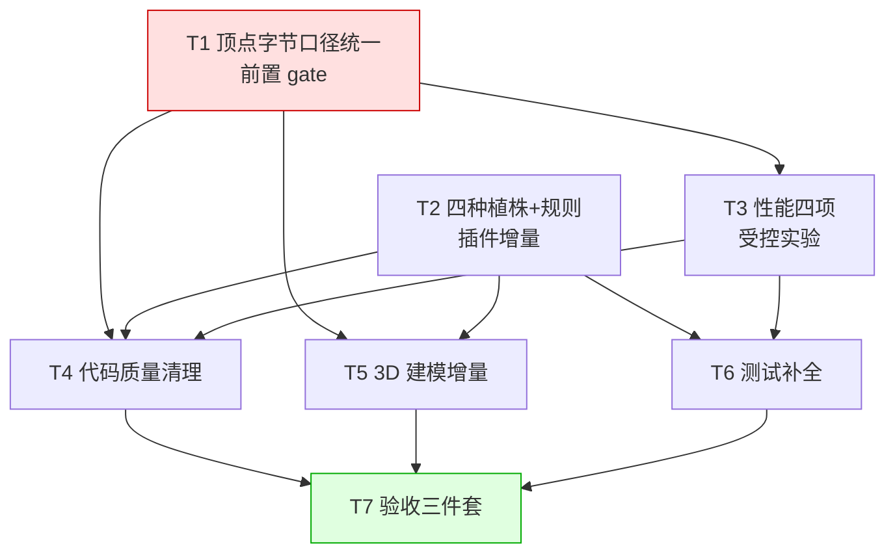

# 四项升级 · 系统设计与任务分解（Implementation Blueprint）

| 项 | 内容 |
|---|---|
| 语言 | 简体中文 |
| 文档类型 | 系统设计 + 有序任务分解（工程蓝图） |
| 上游 PRD | `docs/superpowers/specs/2026-11-22-upgrade-design.md` |
| 仓库 / 基线 | `/workspace/minecraft-web-replica`，main HEAD `1f06d5e`，typecheck 0 error，verify 全绿 |
| 架构师 | 高见远（Gao） |
| 运行时依赖 | three.js（唯一），**本轮新增依赖 0** |
| 已拍板决策 | ①4 种植物走插件扩展 id 165-168；②3D 走现有 three.js 务实增量优化，不做 9 模块内核重构；③性能先统一顶点字节口径再逐项量化，每项带受控实验数据；④验收三件套 = verify 全绿 + 实验前后数据 + 截图人工确认 |

> 本文件是**实现蓝图**，不含实现代码，不修改 `src/` / `test/`。工程师按第 5 节任务表逐批执行；QA 按第 7 节共享约定与第 8 节风险结论验收。

---

## 0. 仓库真实现状核对（设计基线，已在源码逐行确认）

设计不建立在假设上。以下是本轮动笔前从源码确认的事实，与 PRD 描述对照：

| # | 事实 | 源码证据 | 与 PRD 一致性 |
|---|---|---|---|
| F1 | 扩展植物仅 6 种（159-164），规则 4 条（注释仍写"3 条"） | `botanyContent.ts:50-128` / `:179-239`；`botanyExpansion.ts:16,40` | ✅ 相符（规则实为 4 条、注释过期） |
| F2 | 最大内置 id=158；插件植物 159-164；165-168 空闲且 ≤255 | `botanyContent.ts:16-17` 注释仍写"内置 1~138 / FIRST_ID=139"（过期） | ✅ 相符 |
| F3 | **顶点口径三方冲突属实**：注释 11float/44B、实际 12float/48B、闸门 44B | `meshTypes.ts:86-89`（写 44B/11float）vs `GeoArrays`（7 个数组）vs `chunkManager.ts:55-66`（7 个 `setAttribute`）vs `experiment-3d.mjs:521-522`（闸门 44） | ✅ 相符，且**实验闸门当前必失败**（实测 48B） |
| F4 | `injectLight` 每像素 `foliageNoise` 2 次，每次 4 次 `foliageHash` = 8 次 hash | `chunkManager.ts:90-116`（`foliageTint` 调 band+patchN 两次）、`:150` | ✅ 相符 |
| F5 | `computeCornerLightInto` 每面取 3×3 patch（9 格×2 通道）+ 4 角 2×2 均值 | `mesher.ts:187-225`；被 `:308`、`:451` 调用 | ✅ 相符 |
| F6 | `drainResults()` 无界单帧处理整个 `pendingResults` batch | `chunkManager.ts:516-549`；`BACKLOG_LIMIT=24` 在 `:36` | ✅ 相符 |
| F7 | `buildGeo` 每网格 `computeBoundingSphere()` 遍历全顶点 | `chunkManager.ts:53-70`（`:68`）；包围球用于透明排序 `:613` | ✅ 相符 |
| F8 | 规则上下文已具备 4 植物所需的全部能力 | `plantRules.ts:20-54`：`daylight/day()/season()/neighbors()/surface()/isSolid()/boost()/grow()/write()/get()/rng()` 全在 | ✅ 相符，**无需改 PlantRuleContext** |
| F9 | 采集物 key 已全部存在于 `ITEMS` 表 | `survival.ts:45 wheat_seeds`、`:49 nectar`、`:60 glow_spore` | ✅ Q1 复用可行，零内置改动 |
| F10 | 规则执行"全量非短路"，同株可命中多条，按 `(priority,id)` 排序 | `botany.ts:770-778`、`plantRules.ts:105-123` | ✅ 优先级冲突可确定性解决 |
| F11 | 浏览器环境可用（`CHROME` 环境变量 + puppeteer-core 已装） | `experiment-3d.mjs:29-30`、`package.json:69` | ✅ G2 数据验收可闭环（PRD Q2 已解除） |
| F12 | `verify` 为唯一 30+ 组验收入口，`test:experiment` 不挂 verify | `package.json:44` / `:49` | ✅ 相符 |

**关键推论**：F3 意味着**在统一口径前，`npm run test:experiment` 的 E1 闸门（`bytesPerVert===44`）会因实测 48B 直接非零退出**。这正是把 T1 设为前置 gate 的根本原因——不先统一常量来源，T3 的四项性能实验全部无法获得有效数据。

---

## 1. 实现方案总览

### 1.1 总体策略（三句话）

1. **插件路径扩展**：4 种植物 + 4 条规则纯数据追加到 `botanyContent.ts`，由 `botanyExpansion.ts` 现有循环自动注册，核心代码零分支改动（F1/F8/F9 已证实路径畅通）。
2. **性能单点突破**：4 项优化各自独立、各自一份受控 A/B 数据；**不捆绑、不打包**，任一项不达标即单独回滚。
3. **口径统一前置**：先把"每顶点字节"收敛到单一常量来源，`meshTypes.ts` 注释、`EXPERIMENTS.md`、`experiment-3d.mjs` 闸门、`mesher` 断言全部改为引用它，再启动任何性能实验。

### 1.2 分 4 批、7 个任务

| 批次 | 任务 | 目标 | 为何是这个顺序 |
|---|---|---|---|
| 批 0 · 前置 gate | **T1 顶点字节口径统一** | 消灭 48B/44B 冲突，建立唯一常量来源，修好实验闸门 | 不先做，T3 所有实验数据无效（F3） |
| 批 1 · 内容增量 | **T2 四种植物的插件数据 + 规则** | id 165-168 落地，4 机制正交，fake ctx 确定性断言 | 与 T3 渲染优化解耦，可并行准备；但需 T1 的常量无关，理论上可并行 |
| 批 2 · 性能与建模 | **T3 性能四项（受控实验）**、**T5 3D 建模增量** | 逐项 A/B 数据 + 画面增量改进 | T3 依赖 T1；T5 复用 T1 的顶点/风摆管线 |
| 批 3 · 收尾 | **T4 代码质量清理**、**T6 测试补全**、**T7 verify+实验+截图** | 过期口径清零、断言齐全、三件套验收 | 清理与测试依赖前述改动的最终形态，T7 是唯一出口 |

### 1.3 关键设计取舍（明确不做）

- 不做"9 模块分层重建 3D 内核"——所有 3D 改进都在 `mesher.ts` / `chunkManager.ts` / `botanyContent.ts` 的现有函数内增量完成。
- 不新增任何运行时依赖（`package.json` 依赖表保持 three.js 单项）。
- 不改 `blocks.ts` / `atlas.ts` / `plantTraits.ts` / `survival.ts`——4 种植物的方块、纹理、特性、采集 key 全部经插件 API 在运行时注册（G1 硬判据）。
- 不改 Worker/主线程共享的 `MeshSnapshot` 三缓冲契约与 Greedy mask key 位布局（硬规则 6/8）。
- aLight 量化后**保留平滑光照的逐顶点语义**，仅把 sky/block 两分量压进 1 个 float 的位域，不做"整面一个光"的退化。

---

## 2. 总体架构与改动分区

### 2.1 分层归属

```
数据层 src/world/* ── 渲染层 src/world/chunkManager.ts ── 插件层 src/plugins/builtin/*
      ▲                        ▲                                ▲
      └──────── 共享契约 meshTypes.ts（顶点字节唯一来源）────────┘
测试 test/*  ← 引用同一契约 →  文档 docs/*
```

依赖方向仍为 `main → services → api → 业务模块`；插件只依赖 `PluginContext`，不 import 引擎内部实现（架构硬约束）。

### 2.2 改动文件总表

| 相对路径 | 改动类型 | 层 | 改动要点 | 关联任务 |
|---|---|---|---|---|
| `src/world/meshTypes.ts` | **修改** | 数据层 | 新增唯一常量来源 `VERTEX_FLOATS` / `VERTEX_BYTES` / `VERTEX_BYTES_QUANTIZED`；修正 `:86-89` 过期注释（44→48）；为 `lights` 增加位域编码约定注释 | T1 |
| `src/world/chunkManager.ts` | **修改** | 渲染层 | ①`buildGeo` 引用统一常量、包围球缓存优化；②`injectLight`/`FOLIAGE_GLSL` 降噪（可翻转开关）；③`drainResults` 限流；④aLight 1B 量化的 `setAttribute` | T1/T3/T5 |
| `src/world/mesher.ts` | **修改** | 数据层 | `computeCornerLightInto` 采样优化；`quadSky/quadBlock` 位域打包（aLight 量化）；**保持与 Worker 同一份代码** | T1/T3 |
| `src/plugins/builtin/botanyContent.ts` | **修改** | 插件层 | `EXPANSION_PLANTS` 6→10（追加 165-168）、`EXPANSION_RULES` 4→8；修正 `:16-17` id 注释、`:176` "3 条"注释；4 种植物 `paint` 逐像素纹理 | T2/T4 |
| `src/plugins/builtin/botanyExpansion.ts` | **修改** | 插件层 | 仅修 `:16`/`:40` 描述（"3 条"→"4 条/8 条"），注册循环逻辑不动 | T2/T4 |
| `test/experiment-3d.mjs` | **修改** | 测试 | 修 `:5` 过期口径；闸门口径改为"基线 48B / 量化后 44B"双档、引用统一值；新增 E9-E12 A/B arm | T1/T3 |
| `test/mesher-check.cjs` | **修改** | 测试 | 顶点字节断言改为引用统一常量；位域编码的逐顶点等价断言（量化档放宽为 ≤1 档） | T1/T3 |
| `test/botany-rules-check.cjs` | **修改** | 测试 | 修 `:6` "id 契约 120~125"过期注释为 159-168；追加 4 植物 + 4 规则的 fake ctx 确定性断言 | T2/T4/T6 |
| `test/botany-check.cjs` | **修改** | 测试 | 追加攀墙藤向上生长、日晷花分相的随机刻断言（如需） | T2/T6 |
| `test/plant-energy-check.cjs` | **修改** | 测试 | 追加缢丝花能量转移、日晷花蓄能/采集断言 | T2/T6 |
| `docs/EXPERIMENTS.md` | **修改** | 文档 | `:86` 44B 口径改为双档；新增 E9-E12 假设/对照/判据/实测数据 | T1/T3 |
| `docs/ARCHITECTURE.md` | **修改** | 文档 | §8.3.2 顶点布局 44B 口径同步为双档；§8.7 生态扩展点补 8 条规则说明 | T4 |
| `docs/TESTING.md` | **修改** | 文档 | `botany-rules` 组说明改为 159-168 / 8 条规则；顶点字节断言口径 | T4/T6 |
| `docs/PROJECT-EXPERIENCE.md` | **修改** | 文档 | 硬规则"插件扩展植物从 148 起"注释与 id 区间同步（若仍过期） | T4 |
| `docs/superpowers/plans/2026-11-22-upgrade-implementation.md` | 本身（文档） | 文档 | 本文件 | — |

**明确不改动**：`src/world/blocks.ts`、`src/gfx/atlas.ts`、`src/world/plantTraits.ts`、`src/player/survival.ts`、`src/world/plantRules.ts`（接口已够用，F8）、`src/main.ts`（注册接线已由现有循环覆盖）、`test/logic/`、`test/terrain-logic/`、`dist/`、`test/artifacts/`。

### 2.3 如何保证"数据/渲染解耦"硬规则不被破坏

硬规则 6：Worker 侧禁止 import three / World / TextureAtlas，共用同一份 `mesher.ts`。本轮所有渲染侧优化都必须守住三条线：

| 风险动作 | 守住的方式 |
|---|---|
| aLight 量化 | 位域打包只发生在 `mesher.ts` 的 `GeoArrays.lights` 写入端（`PackedGeo` 仍是纯 `Float32Array`）；**不引入任何 three 类型到 mesher**。解码在 `chunkManager.ts` 的 shader/material 侧。Worker 传的仍是同一份 `PackedGeo` 结构。 |
| `computeCornerLightInto` 优化 | 只改 patch 采样逻辑，输入输出仍是 `MeshSource`（纯数据接口）与 `Int32Array`；不读 `World`，不读邻区块活对象。 |
| 包围球缓存 | 完全在 `chunkManager.ts`（主线程渲染层），**不下沉到 mesher**；`PackedGeo` 结构零变化。 |
| `drainResults` 限流 | 完全在 `ChunkManager`（主线程调度），不改 Worker 消息协议（`MeshResult` 字段不变）。 |
| 4 种植物 | 纯数据追加到 `botanyContent.ts`（可编译进快照），装配在 `botanyExpansion.ts`；不 import 引擎内部实现，只经 `ctx.api`。 |

**验证闸门**：`npm run test:mesher`（Worker 与主线程共用 mesher 的逐顶点等价）与 `npm run test:worker-pool`（消息协议/ACK/busy 计数）必须在 T1/T3 每个子项后全绿；任一出现 `three` 被 mesher 引用的迹象即视为破坏硬规则，立即回退。

---

## 3. 数据结构与接口

### 3.1 顶点字节统一常量（T1 的核心产物）

**定义位置**：`src/world/meshTypes.ts` 顶部，作为整个项目唯一的字节口径来源。

```ts
// src/world/meshTypes.ts —— 唯一常量来源（工程师实现，此处为接口契约）
export const VERTEX_FLOATS = 12 as const;                 // position3 + uv2 + shade1 + light2 + tile2 + tint1 + sway1
export const VERTEX_BYTES = VERTEX_FLOATS * 4;             // = 48（Float32 基线，含 aLight 2 float）
export const VERTEX_BYTES_QUANTIZED = VERTEX_BYTES - 4;    // = 44（aLight 2 float → 1 float 位域后）

/** attribute 布局（供 buildGeo 与实验脚本共同引用，避免各自硬编码 12/44/48） */
export const VERTEX_ATTRIBUTES = {
  position: 3, uv: 2, aShade: 1, aLight: 2, aTileOrigin: 2, aTint: 1, aSway: 1,
} as const;  // 量化档把 aLight 由 2 改为 1
```

**引用方式**（禁止任何地方再写死 44 / 48 / 12）：

| 引用方 | 引用形式 |
|---|---|
| `meshTypes.ts:86-89` 注释 | 改为"当前 12 float/48B；aLight 量化后 11 float/44B，见常量" |
| `chunkManager.ts:53-70 buildGeo` | 从常量推导每个 attribute 的 itemSize；`aLight` 依据当前档位取 `VERTEX_ATTRIBUTES.aLight` 或 1 |
| `test/experiment-3d.mjs:521-522` 闸门 | `Math.abs(bytesPerVert - expected) < 0.01`，`expected` 从常量派生（基线档 48 / 量化档 44） |
| `test/mesher-check.cjs` | 顶点字节断言 import 常量 |
| `docs/EXPERIMENTS.md:86` | 表格改双档，注明来源常量 |

> **口径换算说明**：`aLight` 原本是 `vec2(sky, block)` 两个 Float32（各 0~15 归一化后写入），占 8B。量化方案把两分量打包进**一个 Float32** 的高/低 4 位（各 0~15，共 8 位），占 4B，故每顶点 48B→44B。这与"1 字节量化"（48→41B）不同——本轮按 PRD 明确的 **44B 双档**执行，不采用 1 字节。shader 侧用 `mod/floor` 解码还原两个 0~1 分量，量化误差 ≤1 档（0~15 的整数本就是离散的，位域编码**实际无损**，仅归一化除法引入浮点误差）。

### 3.2 四种植物 Trait / 群系 / 采集数据（T2）

全部为 `ExpansionPlant`（`botanyContent.ts:26-41` 已定义）追加项，字段语义不变：

| 名字 / id | trait（metabolism / bloom / growthCost / shareRadius / sharePower / harvest） | spawn（群系权重） | 生成附加 |
|---|---|---|---|
| `climbing_vine` / 165 | solar / 76 / 16 / 2 / 11 / `item:nectar`×1 | forest .006 / taiga .004 / plains .002 | `shape:'cross'`（由 `expansionBlockInput` 统一提供），无 nearWater |
| `parasite_bloom` / 166 | fungal / 70 / 12 / 1 / 6 / `item:glow_spore`×1 | forest .005 / taiga .003 | 无 |
| `windseed_grass` / 167 | solar / 68 / 14 / 2 / 9 / `item:wheat_seeds`×1 | plains .010 / beach .006 / alpine .004 | 无 |
| `sundial_flower` / 168 | solar / 84 / 20 / 2 / 12 / `item:nectar`×2 | plains .004 / forest .003 / alpine .003 | 无 |

**权重上界复核**（追加在数组末尾，既有 6 种命中区间不变）：forest .037 / taiga .007 / plains .014+既有 ≤.034 / beach .036 / alpine .019 / ocean .006，全部 ≤ `SPAWN_ROLL_CEILING=0.04`（`botanyContent.ts:19`），无需改闸门。代谢分布变为 solar 5 / hydro 2 / fungal 3，三类齐全。

### 3.3 四条新规则（rule injection 契约）

注入接口完全复用 `PlantRule`（`plantRules.ts:56-67`）与 `PlantRuleContext`（`:20-54`），**不新增任何接口方法**。`owner` 统一为 `EXPANSION_PLUGIN_ID`（`core:botany-expansion`），经 `api.botany.registerRule` 注入，由 `botanyExpansion.ts:53-55` 的现有循环自动完成。

| 规则 id | priority | plants | 机制要点（依赖的 ctx 能力） |
|---|---|---|---|
| `core:botany-expansion:climbing` | 0（默认） | `climbing_vine` | 水平四邻 `ctx.neighbors` 有实心 `ctx.isSolid` + `ctx.canGrow(x,y+1,z)` + `ctx.rng()≤0.08` → `ctx.grow(...,'grow')`；上限 `y ≤ ctx.surface(x,z)+6`；无墙退化为矮丛 |
| `core:botany-expansion:parasitism` | **1**（先于其他插件规则） | `parasite_bloom` | 邻格植物 `ctx.energy>15` 且非自身 → `ctx.boost(host,-4)` + `ctx.boost(self,+6)`；自身上限 85 钳制；host≤15 停吸并 `ctx.write(...,'decay')`；无宿主时能量 ≤ bloom |
| `core:botany-expansion:wind_dispersal` | 0 | `windseed_grass` | 纯函数 `windDirection(season,day)`（春东/夏南/秋西/冬北，`day%3!==0` 顺时针偏一格）；只下风 1~2 格、`ctx.get===0`、下方 `ctx.isSolid`、`ctx.rng()≤0.05` 且受 `ctx.season()` 倍率 → `ctx.grow(...,'spread')`；方向不依赖 rng |
| `core:botany-expansion:circadian_phase` | 0 | `sundial_flower` | 按 `ctx.daylight` 分相、每 tick 至多一类：黎明 [.15,.4) `ctx.boost(+8)`；正午 ≥.7 且能量≥bloom → `ripen`；黄昏 [.25,.5) `ctx.rng()≤.04` 邻格 `spread`；夜 <.15 零写入 |

**优先级与冲突契约**（F10）：同株命中多条规则时，`Botany.applyAt` 全量执行不短路（`botany.ts:774-777`），排序按 `(priority, id)`（`plantRules.ts:114-118`）。`parasitism` 设 priority=1 使其先于 `cross-pollination`（默认 0）——注意 priority **越小越先**，若设计意图是"寄生先于其他插件规则"，应设 **priority = -1**（见第 8 节风险 R4，PRD 写"priority 1 先于其他"存在语义歧义，需在 T2 明确为 -1 或调整其他规则）。

> 架构结论：`parasite_bloom` 的"上限 85 钳制"不能依赖 `ctx.boost` 的 0~100 钳制（`plantRules.ts:31` 注释明确 0~100）。规则内须在 `boost(self,+6)` 前判断 `ctx.energy(self) ≤ 79` 时改补少量或跳过，从而在 fake ctx 断言中体现 85 自限。

### 3.4 类图（Mermaid classDiagram）



---

## 4. 程序调用流程

### 4.1 时序图①：一株新植物从随机刻命中到生长/采集



### 4.2 时序图②：一次性能优化 A/B 受控实验执行流



---

## 5. 任务列表（核心产物 · 有序、带依赖、带验收判据）

> 按**实现顺序**排列。可并行标记基于依赖关系：T1 是全局前置 gate；T2 理论上不依赖顶点口径，可与 T1 并行准备，但为便于逐批验收，默认排在 T1 之后。T3 的四子项内部可各自独立实验与回滚。

| 编号 | 标题 | 涉及文件 | 前置依赖 | 验收判据 | 可并行 |
|---|---|---|---|---|---|
| **T1** | 顶点字节口径统一（前置 gate） | `src/world/meshTypes.ts`、`src/world/chunkManager.ts`(buildGeo 引用常量)、`src/world/mesher.ts`(引用常量)、`test/mesher-check.cjs`、`test/experiment-3d.mjs:5,521-522`、`docs/EXPERIMENTS.md:86` | 无 | ①唯一常量 `VERTEX_FLOATS/BYTES/BYTES_QUANTIZED` 定义在 `meshTypes.ts`；②全仓 grep 无硬编码 44/48/12 作为字节口径（注释引用常量除外）；③`test:mesher` 51 项全绿；④`test:experiment` 的 E1 闸门在基线档读 48B 通过（不再误判 44）；⑤`typecheck` 0 error | 否（gate） |
| **T2** | 4 种植物 + 4 条规则（插件数据增量） | `src/plugins/builtin/botanyContent.ts`、`src/plugins/builtin/botanyExpansion.ts`(仅描述)、`test/botany-rules-check.cjs`、`test/botany-check.cjs`、`test/plant-energy-check.cjs` | T1（默认顺序；数据本身不依赖口径） | ①`EXPANSION_PLANTS` 6→10、id 159-168 唯一且 ≤255；②`EXPANSION_RULES` 4→8，owner 统一；③4 机制各有 fake ctx 确定性断言（≥12 条新增），阈值边界 .15/.4/.5/.7、host≤15、无墙不 grow、同 seed 十次一致；④`blocks.ts/atlas.ts/plantTraits.ts/survival.ts` diff 为空；⑤`test:botany`34组/`test:plant-energy`54组/`test:botany-rules`51组全绿 | 是（与 T1/T3 可并行准备） |
| **T3** | 性能四项单点优化（各带受控实验） | `src/world/mesher.ts`(computeCornerLightInto、aLight 位域)、`src/world/chunkManager.ts`(injectLight/FOLIAGE_GLSL、drainResults、buildGeo aLight itemSize)、`test/experiment-3d.mjs`(E9-E12 arm)、`test/mesher-check.cjs`、`docs/EXPERIMENTS.md` | T1 | 每项独立 A/B，四项各有 E9-E12 前后数据且 **B→D 噪声底=0**：<br>• aLight 量化：`bytesPerVert` 48→44、mesher 全绿、像素差≤1 档；<br>• injectLight 降噪：`renderMs` 不劣化、像素签名一致或判据内；<br>• drainResults 限流：每帧上限可配(默认4)、BACKLOG_LIMIT=24 语义不变、过期代次回退 busy、无区块永久饥饿、p95 前后数据；<br>• 包围球缓存：剔除正确无可见物消失、renderMs 前后数据；<br>任一不达标即单独回滚，不影响其他项 | 子项间可并行实验 |
| **T4** | 代码质量清理（过期口径归零） | `src/plugins/builtin/botanyContent.ts:16-17,176`、`src/plugins/builtin/botanyExpansion.ts:16,40`、`test/botany-rules-check.cjs:6`、`test/experiment-3d.mjs:5`、`docs/EXPERIMENTS.md`、`docs/ARCHITECTURE.md§8.3.2`、`docs/TESTING.md`、`docs/PROJECT-EXPERIENCE.md` | T1、T2、T3（需最终形态） | ①5 处已知过期口径/注释 100% 修复；②全仓无硬编码 id 区间/"3 条规则"/44B 单档残留；③版本断言动态读 `package.json`/`version.ts`，无字面量；④`check:version`/`lint`/`tsc strict` 0 warning | 否（需最终态） |
| **T5** | 3D 建模增量改进 | `src/plugins/builtin/botanyContent.ts`(4 植物 paint)、`src/world/mesher.ts`(sway 按高度渐变复用)、`src/world/chunkManager.ts`(injectSway 参数) | T1、T2 | ①4 种植物 16×16 逐像素纹理纳入现有管线（复用 aSway，无新通道）；②攀墙藤/风信草/日晷花风摆与相位视觉可辨；③`test:mesher` 全过、无新 shader 通道；④同视角前后截图人工确认"有实质改进无退化" | 是（依赖 T1/T2） |
| **T6** | 测试补全（断言齐全） | `test/botany-rules-check.cjs`、`test/botany-check.cjs`、`test/plant-energy-check.cjs`、`test/mesher-check.cjs`、`test/diagnostics-check.cjs`、`scripts/build-test-snapshot.mjs`(如需新增入口) | T2、T3 | ①新增 ≥12 条植物确定性断言；②每项性能优化有对应 mesher/worker-pool 回归；③新增高风险不变量（id≤255、规则 owner、顶点字节）配注入式回归（P1-12，如纳入）；④`test:snapshot` 后相关组全绿 | 是（随 T2/T3 增量补） |
| **T7** | 验收三件套（verify + 实验 + 截图） | `docs/EXPERIMENTS.md`(汇总表)、`docs/assets/*`(WebP≤1MB)、`test/artifacts/*`(不入库) | T1-T6 全部 | ①`npm run verify` 100% PASS（30+ 组，含植物三组含新断言）；②E9-E12 四项前后数据齐全、噪声底=0；③4 植物 + 3D 改动前后同视角(dayTime .32)截图经主理人人工确认；④原始数据不入库、汇总表入库、WebP≤1MB | 否（唯一出口） |

### 5.1 依赖图（Mermaid）



**分派建议**：第一批只派 T1（gate 绿了再往下）；T2 可与 T1 并行交给第二人；T1 完成后 T3/T5 可并行；T4/T6 收尾；T7 由主理人主持验收。

---

## 6. 依赖包清单（确认新增 0）

| 现有依赖 | 版本 | 本轮用途 |
|---|---|---|
| `three` | 0.170.0 | 唯一运行时依赖，渲染增量全用它，不新增 |
| `puppeteer-core` | ^23.11.1 | 受控实验（已装，浏览器 `/usr/bin/chromium` 可用，F11） |
| `typescript` / `vite` / `biome` / `eslint` / `vitest` 等 | 锁定 | 现有工具链，不改 |

**结论**：`package.json` 的 `dependencies` / `devDependencies` **零改动**。不引入新依赖满足已拍板决策与硬规则（单文件构建、`file://` 可打开）。

---

## 7. 共享知识 / 跨文件约定

### 7.1 命名与常量来源

- 插件 id 统一 `core:botany-expansion`；规则 id 形如 `core:botany-expansion:<rule>`；植物 `name` 用 snake_case（`climbing_vine`），`label` 用中文。
- **字节口径唯一来源**：`meshTypes.ts` 的 `VERTEX_FLOATS/BYTES/BYTES_QUANTIZED`。任何文件禁止硬编码 44/48/12 作为字节含义。
- **id 分配**：内置冻结 1..158；插件植物 159-168（本轮新增 165-168）；全部 ≤255（`Uint8Array`）。新 id 只追加，不重排。
- 采集 key 复用现有 `item:nectar` / `item:glow_spore` / `item:wheat_seeds`（`survival.ts` 已存在，F9），不改 `ITEMS` 表。

### 7.2 测试入口（务必按顺序）

1. 改代码前 `npm run typecheck` 确认基线干净。
2. 每次改动后：`npm run test:snapshot` → 相关 `test:*`（`test:mesher` / `test:worker-pool` / `test:botany*` / `test:plant-energy`）。
3. 性能项额外：`npm run build && npm run test:experiment`（**不挂 verify**，是测量工具）。
4. 唯一验收：`npm run verify` 100% PASS。
5. 纯逻辑优先放 Node 组；新增纯数据入口须登记 `scripts/build-test-snapshot.mjs` 的 `entries`。

### 7.3 受控实验纪律（硬规则 14）

- A/B 必须**同页翻转**；对比前证场景一致（`gen`=49 / 顶点数 / mesh 数 / 分辨率 / 摆放数）；**B→D 噪声底必须为 0**，否则数据作废。
- 像素签名走**归一化坐标**抽样（96×54），避免 SSAA 改分辨率被误判。
- 冻结场景要整体替换 `engine.systems`（闭包 system 按引用过滤无效），并归零 `waterTime`/`localTime` 后再 `sky.update(0,0)`。
- 帧率只在同一页内做相对比较（SwiftShader 软件渲染跨次浮动 1~2fps），结论不依赖绝对帧率。

### 7.4 Git 提交边界（哪些不入库）

| 入库 | 不入库（gitignore） |
|---|---|
| `src/**`、`test/*.cjs`、`test/*.mjs`、`docs/**`、任务卡、脚本 | `test/logic/`、`test/terrain-logic/`（快照）、`dist/`、`test/artifacts/`（`experiment-3d.json`、截图、png） |
| `docs/assets/*.webp`（≤1MB 精简对比图） | >1MB 二进制（硬规则 15） |

- 一次只合一个 PR，绿了再下一个（PROJECT-EXPERIENCE 硬规则）；版本 bump 与断言同步同 commit（本轮如不 bump 则不涉及）。
- 提交信息写清"修了什么 / 为什么"，禁止 `update`。

### 7.5 数据/渲染解耦防线（复核清单）

- `mesher.ts` 不得出现 `import three` / `World` / `TextureAtlas`；位域打包只在 `GeoArrays.lights` 写入端。
- `MeshSnapshot` 三缓冲（`data/sky/block` 各 18×80×18）与 Greedy mask key 位布局（`id|ao<<8|sky<<10|block<<14`）**不动**。
- aLight 量化、包围球缓存、drainResults 限流均不改 `PackedGeo` / `WorkerRequest` / `WorkerResponse` 结构。

---

## 8. 风险与待明确事项

| # | 风险/问题 | 影响 | 缓解方案 | 架构结论 |
|---|---|---|---|---|
| R1 | 受控实验像素判据：aLight 量化/injectLight 降噪的像素差阈值如何定 | 判据过严→假失败回滚；过松→接受退化 | 先测噪声底 B→D=0 作为可信前提；aLight 位域编码本是无损整数（0~15），判据设"像素差=0 或 ≤1 档归一化误差"；injectLight 降噪要求像素签名与对照一致或在 MAD 判据内，且 `renderMs` 不劣化 | 判据写进 EXPERIMENTS.md E9-E12，先测噪声底再下结论 |
| R2 | aLight 量化的视觉误差 | 平滑光照角点精度下降、可能出现色带 | 位域编码保留 0~15 整数精度（无损），仅归一化除法有浮点误差；mesher 逐顶点等价断言在量化档放宽为 ≤1 档；截图人工确认 | 采用 44B 双档（PRD 明确），不做 1 字节 41B |
| R3 | 规则优先级冲突：同株命中多规则 + 寄生与其他插件规则 | 结果不确定、寄生规则被传粉规则放大 | 依赖 F10：`(priority,id)` 稳定排序、全量非短路；给 `parasitism` 显式 priority 保证顺序；fake ctx 断言"同格命中两条规则结果确定" | 见 R4 的 priority 符号修正 |
| R4 | **PRD 语义歧义**：缢丝花"priority 1，先于其他插件规则" | 框架中 priority **越小越先**（`plantRules.ts:64`）；设 1 反而在默认 0 规则之后，与"先于"矛盾 | T2 实现时把 `parasitism` 设为 **priority = -1**（或确认设计意图后调整），并在 fake ctx 中断言执行顺序 | 架构结论：改为 -1，PRD 的"1"按框架语义理解为"需先于"，实际取值 -1 |
| R5 | 缢丝花 85 自限与宿主≤15 停止 | `ctx.boost` 只钳制 0~100，无法直接表达 85 上限 | 规则内 `boost(self,+6)` 前判断 `energy(self)≤79` 时少补或跳过；host≤15 时 `write(...,'decay')`；fake ctx 定点断言 | 不改 PlantRuleContext，规则内自限 |
| R6 | 自然生成权重叠加挤压既有 6 种植物 | 破坏既有生态回归、权重超 0.04 闸门 | 追加在数组末尾（`planSpawn` 顺序累加），既有命中区间不变；复核各群系上界 ≤0.04（§3.2）；`botany-rules` 断言既有 6 种选种不变 | 零改闸门，末尾追加 |
| R7 | 包围球缓存的剔除正确性 | 缓存失效或过时导致可见物消失 | 用区块固定包围盒（cx*16..+16, y 0..80）保守计算，宁大勿小；配置重建（`invalidateConfig`）时失效；截图+剔除断言 | 完全在主线程渲染层，不下沉 mesher |
| R8 | drainResults 限流的饥饿与 busy 计数 | 区块永久不网格化 / busy 永久偏高 | 每帧至少处理上限 N 条（默认 4）；未处理条目保留在队首；config-ack 优先处理；每条回传无论过期都回退 busy（保留 `chunkManager.ts:529` 语义）；p95 前后数据 | BACKLOG_LIMIT=24 背压语义不变 |
| R9 | 浏览器环境（PRD Q2） | G2 数据验收无法闭环 | 已确认 `/usr/bin/chromium` + puppeteer-core 可用（F11），阻塞解除；运行加 `--enable-unsafe-swiftshader` | 无需外部确认，可实测 |

### 8.1 PRD Q1 架构结论（采集物是否新增 item）

**结论：采用"复用现有 key"，不新增 item，P2-14 不启动。**

依据：
1. F9 已证实 `nectar` / `wheat_seeds` / `glow_spore` 三个 key 全部存在于 `survival.ts` 的 `ITEMS` 表（`:45/:49/:60`），字段含义与采集回报完全匹配。
2. 复用可满足 G1 硬判据"对 `blocks.ts`/`atlas.ts`/`plantTraits.ts` 零改动"——若新增 item 必须改 `survival.ts` 内置表，破坏"插件零内置改动"边界。
3. 复用不新增图集 tile（无新纹理），满足"图集 append-only"与"零内置改动"。
4. 新植物的采集差异通过"数量 + 机制"体现（日晷花 nectar×2、寄生花 glow_spore×1、风信草 wheat_seeds×1），不与既有植物冲突。

> 该结论与 PRD §8 Q1 的暂定方案一致，已拍板，不再征求。若未来确需专属采集物，另起 PR 并按"内置表 append-only + 图集末位追加"流程处理（P2-14）。

### 8.2 仍需主理人拍板的开放项（不阻塞开工）

| 项 | 说明 | 建议默认值 |
|---|---|---|
| R4 的 priority 符号 | PRD 写"priority 1"但框架越小越先 | 架构建议 -1，T2 前确认即可 |
| P1 功能是否纳入本轮 | 植物图鉴（P1-10）、实验面板（P1-11）、诊断不变量（P1-12）、截图 diff（P2-16） | 建议本轮只做 T1-T7 的 P0；P1/P2 单列后续批次 |
| 版本 bump | 本轮是否推进 `VERSION`（1.5.3 → ？） | 若 bump，必须与断言同 commit（硬规则） |

---

## 附录 A · 任务执行检查清单（工程师逐卡勾选）

- [ ] T1：常量定义 → 注释/闸门/断言全改引用 → `test:mesher` 绿 → `test:experiment` E1 读 48B 通过
- [ ] T2：数据追加 165-168 + 4 规则 → fake ctx ≥12 断言 → 三组测试绿 → 核心文件 diff 为空
- [ ] T3：四子项各自 A/B → 噪声底=0 → 达标保留/不达标回滚 → E9-E12 数据入档
- [ ] T4：5 处过期口径归零 → 全仓 grep 无硬编码 → lint/tsc 0 warning
- [ ] T5：4 植物纹理 + 风摆 → mesher 绿 → 截图人工确认
- [ ] T6：断言齐全 → 注入式回归 → 相关组全绿
- [ ] T7：verify 100% → 四份实验数据 → 截图确认 → 不入库文件清理

## 附录 B · 验收三件套对照表（QA 用）

| 件套 | 判据 | 输出物 |
|---|---|---|
| verify 全绿 | `npm run verify` 100% PASS，植物三组含新断言 | CI/本地日志 |
| 实验前后数据 | E9-E12 各 A/B 数据，噪声底 B→D=0，无劣化项 | `docs/EXPERIMENTS.md` 汇总表（入库），原始 json 不入库 |
| 截图人工确认 | 4 植物 + 3D 前后同视角(dayTime .32) | `docs/assets/*.webp`（≤1MB，入库），原图 `test/artifacts/`（不入库） |
